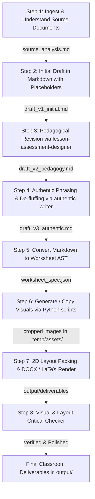

# Assessment Builder Skill

This skill provides an autonomous, multi-phase pipeline that pairs with **`lesson-assessment-designer`** (`.agents/skills/lesson-assessment-designer/SKILL.md`) to build classroom-ready tests, quizzes, retakes, and lesson worksheets.

To maintain speed, eliminate hallucinations, and **prevent context bloat**, every major phase is delegated to a specialized **subagent** with a fresh context window. Intermediate files are exchanged via a strictly standardized folder structure.

---

## 1. Directory Structure & Workspace Hygiene

All assessment and lesson tasks MUST separate deliverables from working files:

```text
<document_workspace>/
├── input/                  # (Optional) Source curriculum documents, exams, or syllabus files (.pdf, .docx)
├── output/                 # Final deliverables ONLY (.docx, .pdf, .tex, final answer keys)
└── _temp/                  # Transient intermediate working files
    ├── assets/             # Generated or cropped figures, plots, grids, and diagrams (.png)
    ├── renders/            # Page preview images rendered for inspection (p1.png, docx_p1.png)
    ├── specs/              # Markdown drafts, WorksheetSpec AST JSON, and RenderPlan JSON
    └── build/              # Python generation scripts, compilation logs (.aux, .log, .fls)
```

---

## 2. Exam Integrity & Item Novelty Rule (Zero Verbatim Copying)

> [!IMPORTANT]
> **STRICT EXAM SECURITY PROTOCOL:**
> If any source document is identified or referenced as an **actual exam** given (or scheduled to be given) to students:
> - **NEVER copy questions verbatim or exactly from it.**
> - **Cognitive & Archetype Mirroring**: Mirror the underlying learning standard, problem structure, and cognitive demand (Smith & Stein).
> - **Substantive Parameter Variation**:
>   - Alter all numerical constants, angle measurements, and coordinate endpoints.
>   - Rotate or reflect geometric figure orientations and change vertex letters.
>   - Modify contextual scenarios in word problems (e.g. changing school store items, sports stats, or business scenarios).
>   - Swap variable names, method signatures, or loop bounds in CS code tracing questions.
> - **Novel Problem Solving**: Ensure that review materials, study packets, and retakes assess authentic student mastery rather than rote recall or memorized answers.

---

## 3. End-to-End Autonomous Pipeline Sequence



---

### Step 1: Ingest & Understand Relevant Documents
**Subagent Role:** `Source Document Researcher`  
**Tools / Skills:** `course-content-extractor` (`.agents/skills/course-content-extractor/SKILL.md`)

1. Read all relevant curriculum sources:
   - High School Geometry district assessments / Form A & B (`OneDrive ... 00 Geometry/Assessments`).
   - AP Statistics Math Medic lesson handouts & keys (`mathmedic-extractor/export/mathmedic/ap-statistics`).
   - AP Statistics College Board released FRQs, rubrics, & Chief Reader reports (`stats-archive`).
   - AP Computer Science CodeHS unit repositories or user-provided files.
2. Synthesize all mathematical concepts, formulas, target learning objectives, common student misconceptions, and question archetypes.
3. Write findings and item notes into `_temp/specs/source_analysis.md`.

---

### Step 2: Initial Draft in Markdown with Visual Placeholders
**Subagent Role:** `Assessment Drafter`  
**Input:** `_temp/specs/source_analysis.md`

1. Draft a complete, test-aligned assessment directly in Markdown.
2. **Enforce Exam Integrity**: If based on an actual active exam, do NOT copy any question exactly. Mirror the cognitive skill, problem archetype, and point weight while varying numbers, orientations, and contexts.
3. Structure the document with metadata, clear sections, numbered questions, point values, and sub-parts.
3. For any problem requiring a diagram, geometric figure, coordinate grid, or data plot, include an explicit image placeholder:
   ```markdown
   #### Problem 4 (Coordinate Transformation Drawing) [3 pts]
   Draw the image of quadrilateral $ABCD$ after a translation that maps $A$ to $A'$. Label the image $A'B'C'D'$.
   - **Image**: `_temp/assets/fig_p4_quadrilateral_grid.png`
   - **Workspace**: 1.0 in
   - **Layout**: side_by_side
   ```
4. For multiple choice items, provide four clean choices: `- [A] ...`, `- [B] ...`, `- [C] ...`, `- [D] ...`.
5. For free response or constructed response, indicate the required clean whitespace (e.g. `- **Workspace**: 0.75 in`). **Never use blank underlines (`____`)**.
6. Save to `_temp/specs/draft_v1_initial.md`.

---

### Step 3: Pedagogical Revision via `lesson-assessment-designer`
**Subagent Role:** `Pedagogical Assessment Auditor`  
**Tools / Skills:** `lesson-assessment-designer` (`.agents/skills/lesson-assessment-designer/SKILL.md`), `classroom-context` (`.agents/skills/classroom-context/SKILL.md`)  
**Input:** `_temp/specs/draft_v1_initial.md`

1. Ground items in the classroom profile:
   - **Room 105 Geometry (Period 4)**: Multimodal scaffolds, color-coded diagrams, linguistic support for MLLs, sentence stems.
   - **Period 5 AP Statistics**: AP CED alignment, conceptual understanding before formulas, statistical argumentation (SOCS, inference, probability modeling).
   - **Period 6 AP Computer Science A**: Precise code syntax, tracing tables, algorithm analysis.
2. **Cognitive Demand Check (Smith & Stein)**: Ensure problems balance procedural fluency with conceptual connections ("Doing Mathematics").
3. **Diagnostic Distractor Construction (Taylor & Nolen Ch. 7)**:
   - Every multiple-choice distractor must target an authentic student error or flawed intuition (e.g. procedural reversal, arithmetic slip, confusing independent with disjoint events).
   - No trivial or throwaway choices.
4. **Constructed Response & Rubrics (Taylor & Nolen Ch. 5 & 8)**:
   - Clear criteria for success and transparent scoring guidelines.
5. Save revised draft to `_temp/specs/draft_v2_pedagogy.md`.

---

### Step 4: Authentic Phrasing & De-fluffing
**Subagent Role:** `Authentic Educational Editor`  
**Tools / Skills:** `authentic-writer` (`.agents/skills/authentic-writer/SKILL.md`), `critical-checker` (`.agents/skills/critical-checker/SKILL.md`)  
**Input:** `_temp/specs/draft_v2_pedagogy.md`

1. **Delete AI Tropes & Banned Vocabulary**:
   - Strip *delve*, *testament*, *crucial*, *pivotal*, *multifaceted*, *vibrant*, *navigate*, *furthermore*, *moreover*.
2. **Eliminate All Em Dashes**:
   - Replace every em dash ("—" or "--") with a comma, parentheses, or separate sentences.
3. **Cut Fluff & Conversational Preambles**:
   - Make question stems direct and straightforward.
   - Remove conversational greetings ("Let's dive into...", "Here is your review").
   - Cut preachy concluding summaries.
4. **Enforce Formatting**:
   - Headings in sentence case.
   - Concise teacher instructions.
5. Save polished draft to `_temp/specs/draft_v3_authentic.md`.

---

### Step 5: Convert Markdown to Worksheet AST
**Subagent Role:** `AST Translation Subagent`  
**Input:** `_temp/specs/draft_v3_authentic.md`

The subagent directly translates the polished Markdown document into the strongly typed `WorksheetSpec` JSON AST (`_temp/specs/worksheet_spec.json`) based on the schema in [`src/worksheet_packer/worksheet_ast.py`](file:///src/worksheet_packer/worksheet_ast.py).

#### AST JSON Structure & Fields:
```json
{
  "title": "Unit 1 Assessment: Transformations & Angle Proofs",
  "subtitle": "Geometry — Period 4",
  "header_right": "Name: ______________________ Date: ________ Period: ____",
  "page_width_in": 8.5,
  "page_height_in": 11.0,
  "margins": { "top_in": 0.45, "bottom_in": 0.45, "left_in": 0.5, "right_in": 0.5 },
  "default_columns": 2,
  "column_gap_in": 0.3,
  "theme_hex": "#1F4E79",
  "default_font": "Calibri",
  "default_font_size_pt": 10.0,
  "sections": [
    {
      "id": "sec_1",
      "title": "PART I: Rigid Transformations",
      "instructions": "Answer all questions. Show your reasoning where requested.",
      "ordering": "strict",
      "problems": [
        {
          "id": "q1",
          "number": 1,
          "points": 2,
          "prompt_text": "Figure ABCDE is shown below alongside candidate reflection images. Which image shows figure ABCDE correctly reflected over line BC?",
          "image": {
            "media_path": "_temp/assets/fig_p1_reflections.png",
            "category": "detailed_diagram",
            "min_width_in": 2.0,
            "max_width_in": 3.4,
            "preferred_width_in": 2.8,
            "has_fine_text": true
          },
          "choices": [
            { "label": "(A)", "text": "Image 1" },
            { "label": "(B)", "text": "Image 2" },
            { "label": "(C)", "text": "Image 3" },
            { "label": "(D)", "text": "Image 4" }
          ],
          "workspace": { "type": "blank", "approx_height_in": 0.5 },
          "layout_hint": "side_by_side"
        }
      ]
    }
  ]
}
```

#### Translation Mapping Rules:
1. **Sections:** Map Markdown `### PART ...` headings to `WorksheetSection(id=..., title=..., ordering="strict"|"flexible")`.
2. **Problems:** Map `#### Problem N (Title) [X pts]` to `Problem(id="qN", number=N, points=X, prompt_text=...)`.
3. **Choices:** Map `- [A]`, `- (A)` lists to `QuestionChoice(label="(A)", text=...)`.
4. **Clean Workspaces:** Map `- **Workspace**: X in` to `WorkspaceConfig(type="blank", approx_height_in=X)`. Never use underlines.
5. **Diagrams & Hints:** Map visual placeholders to `image` configs with appropriate `category` ("detailed_diagram" or "wide_grid") and set `layout_hint = "side_by_side"` for portrait/square diagrams, or `"stacked"` for wide grids.
6. Save the AST JSON to `_temp/specs/worksheet_spec.json`.

---

### Step 6: Generate or Crop Visuals via Python Scripts
**Subagent Role:** `Visual Asset Developer`  
**Tools / Skills:** `curriculum-visual-generator` (`.agents/skills/curriculum-visual-generator/SKILL.md`)  
**Input:** Image placeholders listed in `_temp/specs/worksheet_spec.json`

1. Create a dedicated Python script `_temp/build/generate_figures.py` using `matplotlib`, `numpy`, and `PIL`.
2. Generate crisp, high-DPI (300 DPI) figures:
   - Coordinate planes, geometry polygons, angle arcs, parallel lines, boxplots, or histograms.
   - Or crop and auto-trim diagrams from source PDFs using `auto_crop_image`.
3. Save all images to `_temp/assets/` (e.g. `_temp/assets/fig_p1_reflections.png`).
4. Auto-crop extra whitespace from every generated image so layout engine calculations reflect the exact drawing footprint:
   ```python
   from worksheet_packer.image_utils import auto_crop_image
   auto_crop_image("_temp/assets/fig_p1_reflections.png")
   ```
5. Ensure image paths in `_temp/specs/worksheet_spec.json` point to the generated files.

---

### Step 7: 2D Layout Packing & DOCX / LaTeX Render
**Subagent Role:** `Document Packing Engineer`  
**Tools / Skills:** `worksheet-packer` (`.agents/skills/worksheet-packer/SKILL.md`)  
**Input:** `_temp/specs/worksheet_spec.json` and `_temp/assets/`

1. Execute 2D bin packing to generate the `RenderPlan`:
   ```bash
   uv run worksheet-packer pack _temp/specs/worksheet_spec.json -o _temp/specs/render_plan.json
   ```
2. Render deterministic DOCX and LaTeX deliverables directly to `output/`:
   ```bash
   # DOCX deliverable
   uv run worksheet-packer render _temp/specs/render_plan.json -o output/Assessment.docx --format docx

   # LaTeX & compiled PDF deliverable
   uv run worksheet-packer render _temp/specs/render_plan.json -o output/Assessment.tex --format pdf
   ```

---

### Step 8: Visual & Layout Critical Checker
**Subagent Role:** `Visual Layout Auditor`  
**Tools / Skills:** `visual-layout-checker` (`.agents/skills/visual-layout-checker/SKILL.md`)  
**Input:** `output/Assessment.docx` and `output/Assessment.pdf`

1. Headlessly render page preview images to `_temp/renders/`:
   ```bash
   uv run worksheet-packer render-docx-pages output/Assessment.docx -o _temp/renders/docx_pages --dpi 200
   ```
2. Inspect rendered page images against the Visual Layout Audit Checklist:
   - Diagram legibility, angle labels, and aspect ratio fidelity.
   - Multi-column symmetry and balanced vertical spacing.
   - Side-by-side vs stacked layout elegance.
   - Clean whitespace adequacy for student handwriting.
   - No orphan problems spilling onto unintended trailing pages.
3. If layout issues exist, adjust hints or dimensions in `_temp/specs/worksheet_spec.json`, re-pack, and re-render until flawless.

---

## 3. Subagent Dispatch Guidelines (Preventing Context Bloat)

To maintain a clean parent context, invoke each step with a targeted subagent using `invoke_subagent`:

```python
# Example: Launching Step 3 (Pedagogical Revision)
invoke_subagent(
    Role="Pedagogical Assessment Auditor",
    TypeName="self",
    Prompt="""Read _temp/specs/draft_v1_initial.md and apply .agents/skills/lesson-assessment-designer/SKILL.md.
Review cognitive demand, craft diagnostic distractors (Taylor & Nolen Ch. 7), and add MLL linguistic scaffolds.
Save the revised markdown to _temp/specs/draft_v2_pedagogy.md. Reply with a short bulleted summary of changes."""
)
```

By passing file paths instead of entire file contents through conversational prompts, subagents run with lean context windows, preventing context bloat and rate-limit degradation.

