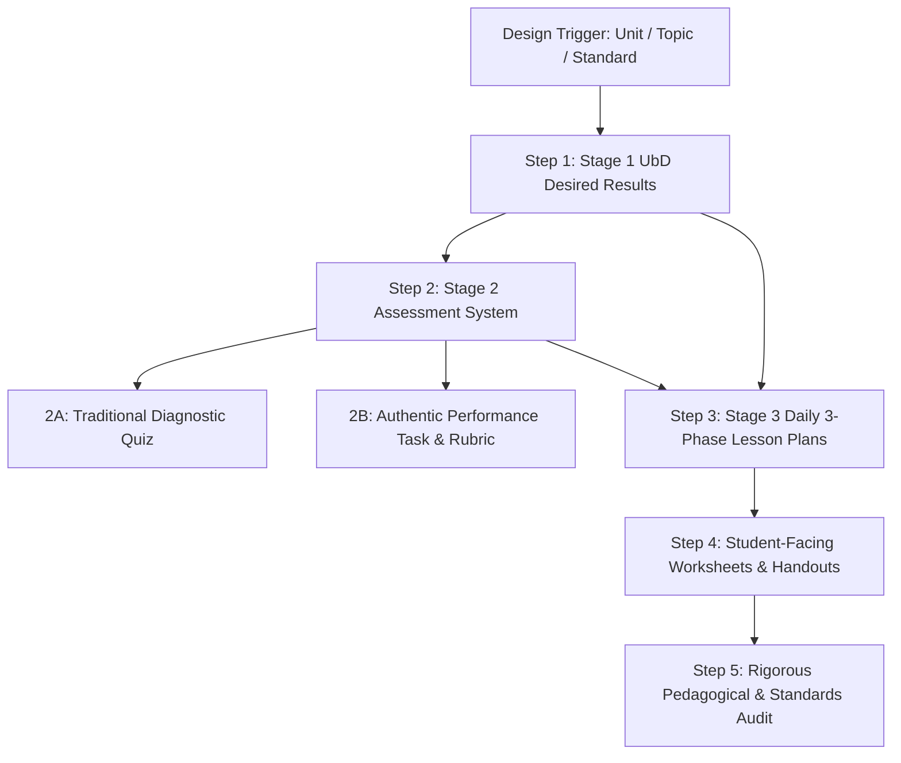

# Lesson, Worksheet & Assessment Designer Skill

This skill provides comprehensive instructions, pedagogical guidelines, automated subagent workflows, and **direct local file paths** for generating classroom-ready lesson plans, student worksheets/handouts, and balanced assessment tools. It synthesizes core literature and templates from **EDTEP 573** (Assessment in Secondary Education) and **EDTEP 582 / 583** (Teaching Mathematics in the Secondary School).

---

## 1. Grounding Literature & Canonical Local File Paths

Every lesson plan, worksheet, or assessment must explicitly anchor in the following course frameworks and readings. Use the exact local file paths below when referencing, reading, or extracting specific criteria:

### A. Assessment Design, Validity, & Item Development (EDTEP 573)
* **Taylor & Nolen (2008) — Chapter 1: Introduction to Assessment**
  * *Focus*: Aligning items to learning objectives, assessment for learning vs. of learning, construct-irrelevant variance.
  * [Taylor___Nolen_Chp1.pdf](file:///c:/Users/zubair/Documents/canvas-extractor/export/edtep-573-a-au-26_-assessment-in-secondary-education/google_drive/readings/Taylor___Nolen_Chp1.pdf)
  * Alternative path: [taylor-&-nolen-chp1.pdf](file:///c:/Users/zubair/Documents/canvas-extractor/export/edtep-573-a-au-26_-assessment-in-secondary-education/files/taylor-&-nolen-chp1.pdf)
* **Taylor & Nolen (2008) — Chapter 5: Performance Assessment, Authentic Tasks, & Writing Directions**
  * *Focus*: Defining valued performances, writing clear student-facing directions, and transparent scoring rubrics.
  * [Taylor___Nolen_Chp5.pdf](file:///c:/Users/zubair/Documents/canvas-extractor/export/edtep-573-a-au-26_-assessment-in-secondary-education/google_drive/readings/Taylor___Nolen_Chp5.pdf)
* **Taylor & Nolen (2008) — Chapter 7: Selected-Response Items and Diagnostic Assessment**
  * *Focus*: Multiple-choice rule checklist, stem clarity, crafting diagnostic distractors from common student misconceptions.
  * [Taylor___Nolen_Chp7.pdf](file:///c:/Users/zubair/Documents/canvas-extractor/export/edtep-573-a-au-26_-assessment-in-secondary-education/google_drive/readings/Taylor___Nolen_Chp7.pdf)
  * Alternative path: [taylor-&-nolen-chp7.pdf](file:///c:/Users/zubair/Documents/canvas-extractor/export/edtep-573-a-au-26_-assessment-in-secondary-education/files/taylor-&-nolen-chp7.pdf)
* **Taylor & Nolen (2008) — Chapter 8: Constructed-Response & Interpretive Exercises**
  * *Focus*: Short-answer, math justification prompts, diagnostic scoring schemes.
  * [Taylor___Nolen_Chp8.pdf](file:///c:/Users/zubair/Documents/canvas-extractor/export/edtep-573-a-au-26_-assessment-in-secondary-education/google_drive/readings/Taylor___Nolen_Chp8.pdf)
  * Alternative path: [taylor-&-nolen-chp8.pdf](file:///c:/Users/zubair/Documents/canvas-extractor/export/edtep-573-a-au-26_-assessment-in-secondary-education/files/taylor-&-nolen-chp8.pdf)
* **Taylor (2022) — Chapter 6: Developing Assessments for Diverse Classrooms**
  * *Focus*: Asset-based design, linguistic scaffolds, accommodations without reducing cognitive demand.
  * [Taylor_2022.pdf](file:///c:/Users/zubair/Documents/canvas-extractor/export/edtep-573-a-au-26_-assessment-in-secondary-education/google_drive/readings/Taylor_2022.pdf)
  * Alternative path: [taylor-2022-culturally_and_socially_responsible_assessment-(chapter-6._developing_assessments_for_diverse_classrooms_).pdf](file:///c:/Users/zubair/Documents/canvas-extractor/export/edtep-573-a-au-26_-assessment-in-secondary-education/files/taylor-2022-culturally_and_socially_responsible_assessment-(chapter-6._developing_assessments_for_diverse_classrooms_).pdf)
* **Multilingual Learner (EL) Assessment Review Protocol**
  * *Focus*: Reviewing student responses, language-sensitive feedback, avoiding English proficiency bias.
  * [reading___how_should_I_review_my_EL_student_responses.pdf](file:///c:/Users/zubair/Documents/canvas-extractor/export/edtep-573-a-au-26_-assessment-in-secondary-education/google_drive/readings/reading___how_should_I_review_my_EL_student_responses.pdf)
* **Chesbro (2010) & Preston & Claypool (2022)**
  * *Focus*: Evaluating multiple-choice items and diagnostic classroom assessment.
  * [Chesbro_2010.pdf](file:///c:/Users/zubair/Documents/canvas-extractor/export/edtep-573-a-au-26_-assessment-in-secondary-education/google_drive/readings/Chesbro_2010.pdf)
  * [Preston_and_Claypool_2022.pdf](file:///c:/Users/zubair/Documents/canvas-extractor/export/edtep-573-a-au-26_-assessment-in-secondary-education/google_drive/readings/Preston_and_Claypool_2022.pdf)
* **Standards-Based Grading (SBG) & Policy Literature**
  * *Focus*: Separating academic achievement from behavioral compliance, retake policies, formative communication.
  * [SBG_resource____Guskey___Jung_2006.pdf](file:///c:/Users/zubair/Documents/canvas-extractor/export/edtep-573-a-au-26_-assessment-in-secondary-education/google_drive/readings/SBG_resource____Guskey___Jung_2006.pdf)
  * [SBG_resource___Scriffiny_2008.pdf](file:///c:/Users/zubair/Documents/canvas-extractor/export/edtep-573-a-au-26_-assessment-in-secondary-education/google_drive/readings/SBG_resource___Scriffiny_2008.pdf)

---

### B. Backward Design, Cognitive Demand & Mathematics Pedagogy (EDTEP 582 & 583)
* **Wiggins & McTighe (1998 / 2005) — Understanding by Design (UbD)**
  * *Focus*: Backward design architecture (Stage 1 Desired Results, Stage 2 Assessment Evidence, Stage 3 Learning Plan).
  * [ubd-backward-design.pdf](file:///c:/Users/zubair/Documents/canvas-extractor/export/edtep-583-a-au-26_-teaching-mathematics-in-the-secondary-school-ii/files/ubd-backward-design.pdf)
  * [UbD_Backward_Design.pdf](file:///c:/Users/zubair/Documents/canvas-extractor/export/edtep-583-a-au-26_-teaching-mathematics-in-the-secondary-school-ii/google_drive/Fall_2026/Week_4/UbD_Backward_Design.pdf)
* **Woodbury (2000) — Teaching Toward Big Ideas in Secondary Mathematics**
  * *Focus*: Framing units around enduring mathematical ideas and non-trivial inquiry questions.
  * [woodbury(2000)_teachingtwrdsbigideasalg.pdf](file:///c:/Users/zubair/Documents/canvas-extractor/export/edtep-583-a-au-26_-teaching-mathematics-in-the-secondary-school-ii/files/woodbury(2000)_teachingtwrdsbigideasalg.pdf)
* **Bartell & Meyer (2008) — Addressing the Equity Principle in Mathematics Classrooms**
  * *Focus*: Access, achievement, and mathematical identity in diverse secondary settings.
  * [equityprinciple_bartell2008.pdf](file:///c:/Users/zubair/Documents/canvas-extractor/export/edtep-583-a-au-26_-teaching-mathematics-in-the-secondary-school-ii/files/equityprinciple_bartell2008.pdf)
* **Smith & Stein (1998) / Cognitive Demand Analysis**
  * *Focus*: Memorization, Procedures Without Connections, Procedures With Connections, Doing Mathematics.
  * [smith-&-stein-(1998).pdf](file:///c:/Users/zubair/Documents/canvas-extractor/export/edtep-582-a-sp-26_-teaching-mathematics-in-the-secondary-school-i/files/smith-&-stein-(1998).pdf)
  * [Levels_of_Cognitive_Demand_Table.pdf](file:///c:/Users/zubair/Documents/canvas-extractor/export/edtep-583-a-au-26_-teaching-mathematics-in-the-secondary-school-ii/google_drive/Spring_2026/Week_7/Levels_of_Cognitive_Demand_Table.pdf)
  * [cognitive-demand-defined.docx](file:///c:/Users/zubair/Documents/canvas-extractor/export/edtep-582-a-sp-26_-teaching-mathematics-in-the-secondary-school-i/files/cognitive-demand-defined.docx)
* **Aguirre et al. (2013) / Cultural & Sociopolitical Mathematics**
  * *Focus*: Connecting mathematics to students' community knowledge and lived experience.
  * [aguirre-et-al-2013-what-math-ch.-1.pdf](file:///c:/Users/zubair/Documents/canvas-extractor/export/edtep-582-a-sp-26_-teaching-mathematics-in-the-secondary-school-i/files/aguirre-et-al-2013-what-math-ch.-1.pdf)
  * [rethinking-math-intro.pdf](file:///c:/Users/zubair/Documents/canvas-extractor/export/edtep-582-a-sp-26_-teaching-mathematics-in-the-secondary-school-i/files/rethinking-math-intro.pdf)
  * [joseph-1987-foundations-of-eurocentrism-in-mathematics.pdf](file:///c:/Users/zubair/Documents/canvas-extractor/export/edtep-582-a-sp-26_-teaching-mathematics-in-the-secondary-school-i/files/joseph-1987-foundations-of-eurocentrism-in-mathematics.pdf)
* **Stigler & Hiebert (1998) / Groupwork & Complex Instruction (Lotan 2003 / Cohen)**
  * *Focus*: Teaching as a cultural activity; managing status and groupwork in heterogenous classrooms.
  * [stigler-&-hiebert-(1998)-teaching-is-a-cultural-activity.pdf](file:///c:/Users/zubair/Documents/canvas-extractor/export/edtep-582-a-sp-26_-teaching-mathematics-in-the-secondary-school-i/files/stigler-&-hiebert-(1998)-teaching-is-a-cultural-activity.pdf)
  * [lotan-(2003).pdf](file:///c:/Users/zubair/Documents/canvas-extractor/export/edtep-582-a-sp-26_-teaching-mathematics-in-the-secondary-school-i/files/lotan-(2003).pdf)
  * [cohench1&2.pdf](file:///c:/Users/zubair/Documents/canvas-extractor/export/edtep-582-a-sp-26_-teaching-mathematics-in-the-secondary-school-i/files/cohench1&2.pdf)

---

### C. Multilingual Learner (MLL) Scaffolding & Disciplinary Literacy (EDTEP 575)
* **Moschkovich (2013) — Mathematics, the Common Core, and Language**
  * *Focus*: Language as an asset; prioritizing mathematical reasoning/meaning over grammatical form; multimodal communication.
  * [02-jmoschkovich-math-final_bound-with-appendix-(7).pdf](file:///c:/Users/zubair/Documents/canvas-extractor/export/edtep-575-a&b-su-26_-language-&-literacy-(l&l)/files/02-jmoschkovich-math-final_bound-with-appendix-(7).pdf)
* **Roberts et al. (2022) — Three Ways to Enhance Tasks for Multilingual Learners**
  * *Focus*: Connecting multiple representations, unpacking polysemous words/language obstacles, and real-world contextualization.
  * [[23300582---mathematics-teacher_-learning-and-teaching-pk-12]-three-ways-to-enhance-tasks-for-multilingual-learners.pdf](file:///c:/Users/zubair/Documents/canvas-extractor/export/edtep-575-a&b-su-26_-language-&-literacy-(l&l)/files/%5B23300582---mathematics-teacher_-learning-and-teaching-pk-12%5D-three-ways-to-enhance-tasks-for-multilingual-learners.pdf)
* **García et al. (2017) — The Translanguaging Classroom**
  * *Focus*: Leveraging students' complete unitary linguistic repertoire for rough-draft talk, peer collaboration, and sense-making.
  * [garci'a,-ibarra-johnson-&-seltzer-(2017)_ch.-1pdf.pdf](file:///c:/Users/zubair/Documents/canvas-extractor/export/edtep-575-a&b-su-26_-language-&-literacy-(l&l)/files/garci'a,-ibarra-johnson-&-seltzer-(2017)_ch.-1pdf.pdf)
* **WIDA Framework & Can-Do Descriptors (Grades 9–12)**
  * *Focus*: Word, Sentence, and Discourse dimensions of academic language; Recount, Explain, Argue, Discuss.
  * [wida_features_of_academic_language.pdf](file:///c:/Users/zubair/Documents/canvas-extractor/export/edtep-575-a&b-su-26_-language-&-literacy-(l&l)/files/wida_features_of_academic_language.pdf)
  * [cando-keyuses-gr-9-12.pdf](file:///c:/Users/zubair/Documents/canvas-extractor/export/edtep-575-a&b-su-26_-language-&-literacy-(l&l)/files/cando-keyuses-gr-9-12.pdf)
* **Accountable Talk & Scaffolding Routines (3-Reads & Rodriguez-Mojica)**
  * *Focus*: De-escalating reading barriers through structured word problem reading; tiered sentence frames for justification.
  * [3-reads.pdf](file:///c:/Users/zubair/Documents/canvas-extractor/export/edtep-575-a&b-su-26_-language-&-literacy-(l&l)/files/3-reads.pdf)
  * [accountable-talk-sourcebook_2016_pp.21---27_teacher-moves-only.pdf](file:///c:/Users/zubair/Documents/canvas-extractor/export/edtep-575-a&b-su-26_-language-&-literacy-(l&l)/files/accountable-talk-sourcebook_2016_pp.21---27_teacher-moves-only.pdf)
  * [rodriguez-mojica-2018---sentence-stems-that-support-reading-comprehension.pdf](file:///c:/Users/zubair/Documents/canvas-extractor/export/edtep-575-a&b-su-26_-language-&-literacy-(l&l)/files/rodriguez-mojica-2018---sentence-stems-that-support-reading-comprehension.pdf)
  * *Dedicated Skill Link*: [`mll-literacy-scaffolding`](file:///c:/Users/zubair/Documents/canvas-extractor/.agents/skills/mll-literacy-scaffolding/SKILL.md)

---

### D. Official Planning Templates & Evaluation Rubrics
* **Math Lesson Plan Template (Three-Phase: Launch $\to$ Explore $\to$ Summarize)**:
  * [MathLessonPlanTemplateFall2026.docx](file:///c:/Users/zubair/Documents/canvas-extractor/export/edtep-583-a-au-26_-teaching-mathematics-in-the-secondary-school-ii/google_drive/Fall_2026/Week_3/MathLessonPlanTemplateFall2026.docx)
* **Backward Planning Unit Template (UbD Stages 1, 2, 3)**:
  * [Backward_Planning_Template.docx](file:///c:/Users/zubair/Documents/canvas-extractor/export/edtep-583-a-au-26_-teaching-mathematics-in-the-secondary-school-ii/google_drive/Fall_2026/Week_4/Backward_Planning_Template.docx)
* **Micro-Teaching Launch Rubric**:
  * [MT_LAUNCHrubricSpring2026.docx](file:///c:/Users/zubair/Documents/canvas-extractor/export/edtep-583-a-au-26_-teaching-mathematics-in-the-secondary-school-ii/google_drive/Spring_2026/Week_8/MT_LAUNCHrubricSpring2026.docx)
* **College Board AP Statistics Course and Exam Description (CED)**:
  * [ap-statistics-course-and-exam-description.pdf](file:///c:/Users/zubair/Documents/canvas-extractor/export/edtep-583-a-au-26_-teaching-mathematics-in-the-secondary-school-ii/standards/ap-statistics-course-and-exam-description.pdf)

---

## 2. Classroom & Student Profile Grounding

Always ground outputs in the specific course context (see [classroom-context](file:///c:/Users/zubair/Documents/canvas-extractor/.agents/skills/classroom-context/SKILL.md) and [mll-literacy-scaffolding](file:///c:/Users/zubair/Documents/canvas-extractor/.agents/skills/mll-literacy-scaffolding/SKILL.md)):
- **Franklin High School, Room 105** (Teacher: Zubair Ahmed).
- **Period 4 (Geometry)**: High proportion of Multilingual Learners (MLLs). Needs multimodal representations, color-coded geometric diagrams, structured talk protocols (Turn & Talk, Accountable Talk, whiteboards), translanguaging opportunities (García et al., 2017), 3-Reads routines for word problems, and explicit language scaffolds (tiered sentence frames per Rodriguez-Mojica, 2018; unpacking polysemous words per Roberts et al., 2022).
- **Period 5 (AP Statistics)**: Advanced elective; conceptual understanding before formulas; statistical argumentation; AP CED alignment (SOCS, inference, probability modeling); contextual data literacy; WIDA-aligned disciplinary writing supports for FRQs.
- **Period 6 (AP Computer Science A)**: Tracing, algorithm design, debugging resilience, pair programming, decomposing abstract concepts.

---

## 3. Workflow Pipelines

---

### Step 1: UbD Stage 1 — Desired Results & Big Ideas
- **Established Goals**: Official CCSS-M and AP CED topic codes (via [common-core-standards](file:///c:/Users/zubair/Documents/canvas-extractor/.agents/skills/common-core-standards/SKILL.md)).
- **Transfer Goals**: What should students be able to independently do with this knowledge beyond this specific classroom?
- **Essential Questions (EQs)**:
  - Must be open-ended, non-trivial, and intellectually engaging (e.g., *"When does citing the mean income or home price conceal neighborhood realities compared to the median?"*).
- **Enduring Understandings**: Big mathematical truths that connect concepts.
- **Dual Learning Targets**:
  - *Conceptual*: "Students will understand that..."
  - *Procedural/Skill*: "Students will be able to calculate/construct/justify..."

---

### Step 2: Assessment Architecture

#### 2A. Traditional Items (Quizzes & Diagnostic Tests)
Adhere strictly to **Taylor & Nolen Chapters 6, 7, & 8**:
- **Test Blueprints / Mapping**: Every item explicitly maps to a target learning objective, Bloom/cognitive level, and point value.
- **Stem Design**: Focused problem; self-contained question; no extraneous narrative unless relevant context.
- **Diagnostic Distractor Construction**:
  - Never include obviously ridiculous options.
  - Option A: Common procedural reversal or arithmetic lapse.
  - Option B: Flawed intuition / common student alternative conception (e.g., confusing disjoint events with independent events).
  - Option C: Partially correct step without complete execution.
  - Option D: Correct target answer.
- **Item Rationales**: Provide full answer keys detailing exactly what error each distractor diagnoses and instructional remediation.

#### 2B. Authentic Performance Assessment
Adhere strictly to **Taylor & Nolen Chapter 5**:
- **Real-World / Contextual Scenario**: Authentic role and audience (e.g., policy analyst examining municipal transit data, urban planner, medical researcher).
- **Clear Student Directions**: Detailed purpose, task constraints, required deliverables, and criteria for success.
- **Analytic Scoring Rubric**:
  - 4 proficiency levels: Advanced (4), Proficient (3), Developing (2), Beginning (1).
  - Distinct dimensions: Mathematical Conceptual Understanding, Procedural Accuracy, Disciplinary Communication / Argumentation, and Contextual Interpretation.

---

### Step 3: Three-Phase Lesson Plan Development
Follow the **EDTEP 583 Math Lesson Plan Framework** (`MathLessonPlanTemplateFall2026.docx`):

1. **Launch Phase (10–15 mins)**:
   - *Hook / Provocation*: Low-floor, high-ceiling entry point (e.g., Notice & Wonder, Which One Doesn't Belong, 3-Act Math, Same But Different).
   - *Activating Prior Knowledge*: Connect to prior lessons or lived experiences.
   - *Setting the Inquiry*: Establish task expectations and collaborative group norms without revealing the solution method (Phil Daro: *Against Answer-Getting*).
2. **Explore Phase (25–30 mins)**:
   - *Collaborative Investigation*: Students work in pairs or trios on rich tasks (Smith & Stein cognitive demand).
   - *Teacher Moves (5 Practices)*:
     - **Anticipating**: Predicted student strategies (visual, numerical, algebraic, erroneous).
     - **Monitoring**: Observing group progress with purposeful circulation.
     - **Scaffolding Questions**: Assessing questions (probe student thinking) and advancing questions (push thinking forward when stuck, without spoon-feeding).
3. **Summarize Phase (15–20 mins)**:
   - *Whole-Class Synthesis*: Orchestrated student share-out.
   - *Sequencing & Connecting*: Compare contrasting student methods (e.g., visual tree diagram vs. formulaic conditional probability).
   - *Formative Exit Ticket*: 1–2 focused questions to gauge daily mastery.

---

### Step 4: Student-Facing Worksheets & Handouts
- **Header & Framing**: Clear title, student name/date/period, learning target, and central essential question.
- **Visual Scaffolds**: Clean coordinate grids, tables with sufficient whitespace, callout boxes for definitions, and minimal visual clutter.
- **Section Progression**:
  - `Part 1: Launch & Warm-Up` (Accessible entry)
  - `Part 2: Group Investigation` (Core inquiry task with guiding sub-questions)
  - `Part 3: Synthesize & Check for Understanding` (Consolidation)
  - `Part 4: Exit Ticket / Reflection` (Formative pulse check)
- **Teacher Answer Key**: Complete solutions with anticipated student difficulties highlighted.

---

## 4. Quality Checklist & Verification Rules

Before finalizing any lesson plan, worksheet, or assessment:
- [ ] **Cognitive Demand Check**: Does the lesson allow students to reason mathematically, or is it merely recipe following?
- [ ] **Equity & Access Check**: Are there multimodal scaffolds (visual, verbal, symbolic) for MLL students?
- [ ] **Assessment Alignment**: Does every assessment item directly measure a stated Stage 1 learning objective?
- [ ] **Distractor Audit**: Are multiple-choice distractors grounded in diagnostic student misconceptions?
- [ ] **Rubric Clarity**: Are rubric criteria qualitative, objective, and transparent to students?
