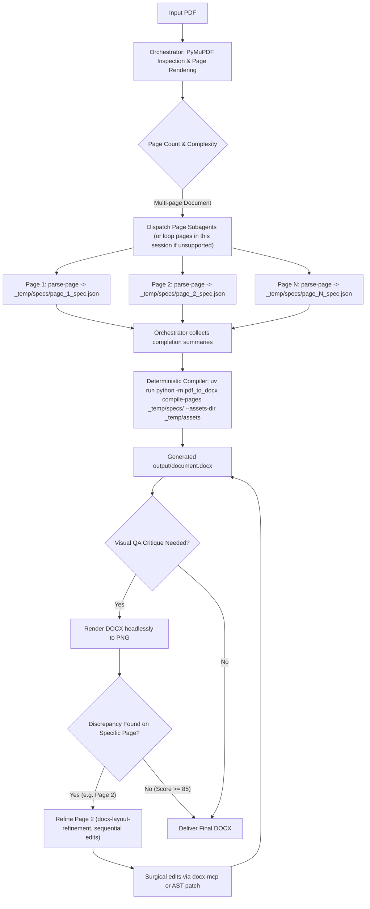

# PDF to DOCX Conversion Workflow Playbook

This playbook guides the agent on strategy selection, execution tradeoffs, subagent orchestration, and context conservation protocols.

> **Subagents are optional.** Use one subagent per page (or per section) when the environment supports subagents: the orchestrator renders pages, launches page subagents with the page image path and the output spec path, and merges. If subagents are not available (e.g., Microsoft Copilot), process pages one at a time in this session with the same files, using the templates below as your own per-page checklist.
>
> All paths follow the repo `AGENTS.md` layout: page renders in `_temp/renders/page_{k}.png` (the names `render-pages` writes), page specs/markdown in `_temp/specs/`, cropped assets in `_temp/assets/`, final DOCX in `output/`.

---

## Strategy Comparison Matrix

| Strategy | Speed | Fidelity | Best Use Case | Risk / Limitations | Subagent Pattern |
| :--- | :--- | :--- | :--- | :--- | :--- |
| **Block-Based IR (Pydantic + python-docx)** | Medium (1-3s/page) | **Highest** | Analytical reports, tables, figures, charts, corporate styles | Requires structured extraction pass | 1 subagent per page (or sequential) outputs `_temp/specs/page_{k}_spec.json` |
| **Fast-Track Markdown (docx-mcp)** | **Fastest** (<1s/page) | High for text | Articles, technical documentation, simple tabular layouts | Does not preserve custom chart vector styles or tight bounding box wraps | 1 subagent per page (or sequential) outputs `_temp/specs/page_{k}.md` |
| **CodeAgent Sandbox Script** | Variable | Maximum flexibility | Unusual bespoke layouts, math formulas, complex multi-column grids | Script execution overhead | Sandbox subagent if available, else this session |

---

## Recommended Decision Tree & Subagent Orchestration



---

## Context Window Conservation Protocol

### Why Monolithic Processing Fails
In a monolithic run, an LLM attempting to convert a 5-page PDF sequentially will:
1. Ingest 5 high-resolution page images (~10,000–15,000 tokens each).
2. Generate verbose AST JSON representations with hundreds of nested spans, bounding boxes, and cells (~3,000–8,000 tokens per page).
3. Accumulate terminal execution logs, diff critiques, and intermediate tool responses.
4. Total tokens can rapidly exceed 100,000+ tokens within 4-5 pages, causing:
   - **Attention dilution**: The LLM forgets earlier formatting rules or drops table columns.
   - **Severe latency**: Massive prompts slow down every single subsequent tool invocation.
   - **Token ceiling crashes**: Hitting model context caps prematurely.

### The Subagent Solution: Strict Context Boundaries
When subagents are available, delegate each page to an independent subagent:
- **Parent Orchestrator Context**: Stays roughly constant. It only stores:
  - Document metadata (page count $N$, dimensions, orientation).
  - The subagent launch payload (page number, image path, output spec path).
  - The concise 2-line completion summaries from each subagent.
- **Page Subagent Context**: Each subagent gets a fresh context:
  - Only inspects `_temp/renders/page_{k}.png`.
  - Only generates and validates `_temp/specs/page_{k}_spec.json`.
  - Terminates and frees its memory upon completion.
- **Fault Isolation**: If Page 3 encounters a parsing error or missing asset, only Subagent 3 is re-invoked. The orchestrator's history is never polluted with failed retries.

**Without subagents:** handle one page at a time, write its spec to disk, keep only a 1-2 line note per page in chat, and do not reopen earlier page images or JSON unless a check fails.

---

## Subagent Dispatch Contracts

### 1. Block-Based IR Subagent Prompt Template
```text
You are the isolated Page {k} Extractor subagent for document '{pdf_path}'.
Input page render: '_temp/renders/page_{k}.png'.

Tasks:
1. Extract Page {k} layout into the canonical PageSpec JSON format:
   uv run python -m pdf_to_docx parse-page {pdf_path} --page {k} --image _temp/renders/page_{k}.png -o _temp/specs/page_{k}_spec.json --assets-dir _temp/assets
2. Read the resulting JSON and verify:
   - All headings and paragraphs are preserved.
   - Tables contain correct column counts, headers, and cell values.
   - Figures/logos are properly cropped into '_temp/assets/'.
3. Respond to parent orchestrator with a concise 2-line summary:
   "Page {k} extraction complete: {num_blocks} blocks, {num_tables} tables, {num_charts} charts saved to _temp/specs/page_{k}_spec.json."
Do NOT output the raw JSON in your response to keep the parent context clean.
```

### 2. Fast-Track Markdown Subagent Prompt Template
```text
You are the isolated Page {k} Markdown Extractor subagent for document '{pdf_path}'.
Input page render: '_temp/renders/page_{k}.png'.

Tasks:
1. Extract Page {k} into GitHub-Flavored Markdown:
   uv run python -m pdf_to_docx to-markdown-page {pdf_path} --page {k} --image _temp/renders/page_{k}.png -o _temp/specs/page_{k}.md
2. Respond with a concise 1-line confirmation:
   "Page {k} markdown exported to _temp/specs/page_{k}.md."
```

---

## Best Practices & Anti-Patterns

### Anti-Patterns to Avoid
1. **Never hold every page's extraction in one context**:
   - Dispatch page subagents for pages $1..N$ when available; otherwise process one page at a time, writing each spec to disk before the next.
2. **Never return raw JSON payloads from subagents to the parent agent**:
   - Subagents must write JSON directly to `_temp/specs/page_{k}_spec.json` and return only an executive confirmation.
3. **Never make dozens of linear MCP calls for basic layout construction**:
   - Calling `add_table`, `add_row`, `modify_cell`, `set_formatting` over 50 roundtrips is slow and fragile.
   - Instead, compile the full table or document atomically using `DocxCompiler` or `docx-mcp: create_from_markdown`.
4. **Never rely solely on text OCR**:
   - OCR loses font sizing, line spacing, table borders, and bounding boxes.
   - Always use Gemini Flash multimodal spatial parsing with PyMuPDF high-DPI rasterization.

### Critical OpenXML Formatting Rules
1. **Page Breaks within Table Rows**: Always ensure table rows have `<w:cantSplit/>` so that a row is not sliced in half across a page boundary.
2. **Multi-Page Tables**: Always set `<w:tblHeader/>` on row 0 so table headers automatically repeat when a table extends past page 1.
3. **Column Widths**: Calculate explicit column widths in twips (`1 inch = 1440 twips`) rather than relying on Word's auto-fit, which frequently shifts during cross-platform rendering.
