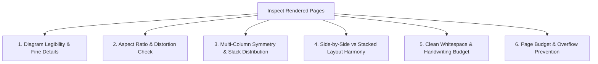

# Visual & Layout Critical Checker Skill

This skill provides an objective, rigorous visual inspection protocol for evaluating rendered Microsoft Word (`.docx`) and LaTeX (`.pdf`) assessment pages.

It inspects rendered high-resolution page PNGs to verify that all figures, coordinate grids, mathematical notation, and student work areas are visually aligned, perfectly legible, and packed with balanced whitespace.

---

## 1. Page Rendering Protocol

Always render pages into `_temp/renders/` before inspection:

### A. Word Documents (.docx)
```bash
uv run worksheet-packer render-docx-pages output/Assessment.docx -o _temp/renders/docx_pages --dpi 200
```
*(Uses headless LibreOffice or Windows Word COM to render pixel-perfect page images `page_1.png`, `page_2.png`).*

### B. LaTeX / PDF Documents (.pdf)
Render PDF pages using PyMuPDF:
```bash
uv run python -c "import fitz, pathlib; doc = fitz.open('output/Assessment.pdf'); [page.get_pixmap(dpi=200).save(f'_temp/renders/pdf_pages/page_{i+1}.png') for i, page in enumerate(doc)]"
```

---

## 2. Visual Layout Audit Checklist

When reviewing rendered page images, evaluate every item against these 6 core criteria:



### 1. Diagram Legibility & Fine Details
- **Angle Marks & Arc Symbols:** Are angle labels (e.g., $120^\circ$, $x^\circ$, $\angle AHB$) crisp and clearly readable?
- **Point & Vertex Labels:** Are letters ($A, B, C, P, Q$) distinct and properly positioned near their vertices, not colliding with polygon edges?
- **Coordinate Grids:** Are grid lines visible, axis ticks numbered, and origin $(0,0)$ clear?
- **Code / Monospace Blocks:** Is code text legible with clean indentation and no clipping?

### 2. Aspect Ratio & Distortion Check
- **No Non-Uniform Stretching:** Circles must remain circular, squares must remain square. Diagrams must never be squished horizontally or stretched vertically.
- **Appropriate Scaling Ceiling:** Diagrams must look naturally proportioned—not cartoonishly oversized or microscopic.
- **No Dark/Dirty Backgrounds:** All diagram backgrounds must be pure white (`#FFFFFF`) or transparent, seamlessly matching the page background.

### 3. Multi-Column Symmetry & Slack Distribution
- **Column Balance:** In a 2-column layout, problems must be evenly distributed across columns (e.g. 3 questions in Column 0, 3 in Column 1). One column must never be crowded while the adjacent column has 5 inches of empty void.
- **Vertical Slack Fill:** Check that inter-problem spacing distributes vertical slack smoothly so questions fill the full height of the page naturally without abrupt gaps at the bottom.

### 4. Side-by-Side vs Stacked Layout Harmony
- **Side-by-Side Containers:** Square-ish or portrait diagrams ($0.55 \le AR \le 1.50$) should sit side-by-side with question text in borderless table cells. The diagram cell and text cell must have consistent vertical alignment (top-aligned).
- **Stacked Containers:** Wide diagrams (e.g. wide coordinate planes, multi-figure comparisons) must span the column width or page width with text positioned cleanly above the image.
- **No Text Collisions:** Text must never overlap or clip diagram borders.

### 5. Clean Whitespace & Handwriting Budget
- **Zero Blank Underlines:** Strictly verify that NO blank underlines (`_______` or `\hrule`) exist for student work.
- **Sufficient Work Area:** Blank workspace gaps must provide adequate space for student calculations:
  - 1-step arithmetic / simple MCQs: minimal whitespace or `workspace.type = none`.
  - Multi-step algebraic work: $0.6 - 1.0$ inches of clean whitespace.
  - Coordinate transformations or proofs: $1.0 - 1.5$ inches.

### 6. Page Budget & Overflow Prevention
- **Strict Page Count:** A 2-page document must be exactly 2 pages.
- **No Orphan Spills:** A single problem or answer line must never spill onto an unintended trailing page (e.g., Page 3 having only 2 lines of text).

---

## 3. Surgical Remediation Recipes

If the visual audit identifies issues, apply these direct fixes in `_temp/specs/worksheet_spec.json` and re-pack:

| Visual Defect | Root Cause | Surgical Fix in `worksheet_spec.json` |
| :--- | :--- | :--- |
| **Diagram too small / illegible** | `min_width_in` or `preferred_width_in` too low | Increase `min_width_in` to $2.0$ in or set `layout_hint = "stacked"` |
| **Diagram oversized** | `max_width_in` too high for column | Reduce `max_width_in` to $3.0$ in or `preferred_width_in` to $2.2$ in |
| **Awkward 1-line spill to next page** | Workspace heights or font slightly too large | Decrease `default_font_size_pt` by $0.5$ pt (e.g. $10.0 \to 9.5$) or reduce `workspace.approx_height_in` by $0.1$ in |
| **Uneven columns (4 vs 2)** | Section ordering constraint or tall problem | Set `"ordering": "flexible"` or set `layout_hint = "side_by_side"` |
| **Diagram stretched or blurry** | Generated raster image resolution low | Regenerate diagram script at `--dpi 300` and ensure aspect ratio matches native pixels |

---

## 4. Audit Procedure (Sequential, No Subagents)

> [!IMPORTANT]
> **Do not start subagents or use agent-delegation tools** (e.g., `invoke_subagent`, `task`). Microsoft Copilot and similar environments may not support them.

Perform the visual audit in the current session:
1. Render page images to `_temp/renders/docx_pages/` (or `pdf_pages/`).
2. Inspect each page against the Visual Layout Audit Checklist (legibility/aspect ratio, column balance/slack, layout harmony, clean whitespace, page budget/overflow).
3. Record a short per-page verdict and any defects.
4. If issues are found, update `_temp/specs/worksheet_spec.json` (or the relevant source), re-pack with `uv run worksheet-packer pack`, and re-render; re-audit affected pages.
5. Report the final verdict: `PASS` or `CORRECTED`, with a brief summary of changes.

