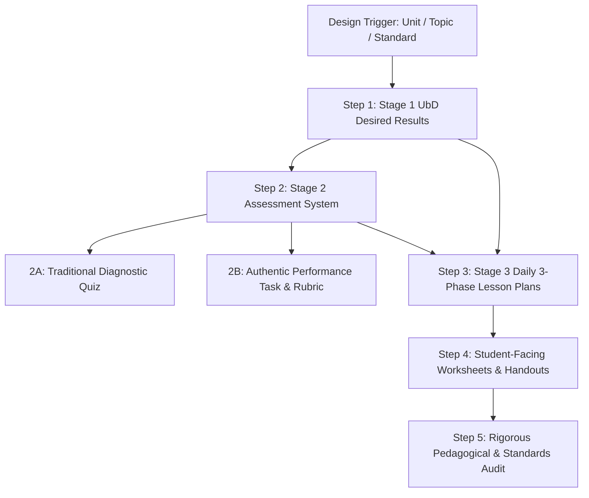

# Skill: lesson-assessment-designer

## Description

_Source: `C:\Users\zubair\Documents\GitHub\pdf-to-docx\.agents\skills\lesson-assessment-designer\SKILL.md`

```markdown
---
name: lesson-assessment-designer
description: Designs standards-aligned, equity-centered secondary mathematics lesson plans, student inquiry worksheets, and balanced assessment systems (traditional tests, diagnostic items, and authentic performance tasks) synthesizing Taylor & Nolen (2008), Wiggins & McTighe UbD, and Smith & Stein 5 Practices.
---

# Lesson, Worksheet & Assessment Designer Skill

This skill provides comprehensive instructions, pedagogical guidelines, and **direct local file paths** for generating classroom-ready lesson plans, student worksheets/handouts, and balanced assessment tools. Execute steps sequentially in the current session (do **not** start subagents or use agent-delegation tools). It synthesizes core literature and templates from **EDTEP 573** (Assessment in Secondary Education) and **EDTEP 582 / 583** (Teaching Mathematics in the Secondary School).

---

## 1. Grounding Literature & Canonical Local File Paths

Every lesson plan, worksheet, or assessment must explicitly anchor in the following course frameworks and readings. Use the exact local file paths below when referencing, reading, or extracting specific criteria:

### A. Assessment Design, Validity, & Item Development (EDTEP 573)
* **Taylor & Nolen (2008) — Chapter 1: Introduction to Assessment**
  * *Focus*: Aligning items to learning objectives, assessment for learning vs. of learning, construct-irrelevant variance.
  * [Taylor___Nolen_Chp1.pdf](file:///c:/Users/zubair/Documents/canvas-extractor/export/edtep-573-a-au-26_-assessment-in-secondary-education/google_drive/readings/Taylor___Nolen_Chp1.pdf)
  * Alternative path: [taylor-&-nolen-chp1.pdf](file:///c:/Users/zubair/Documents/canvas-extractor/export/edtep-573-a-au-26_-assessment-in-secondary-education/files/taylor-&-nolen-chp1.pdf)
* **Taylor & Nolen (2008) — Chapter 5: Performance Assessment, Authentic Tasks, & Writing Directions**
  * *Focus*: Defining valued performances, writing clear student-facing directions, and transparent scoring rubrics.
  * [Taylor___Nolen_Chp5.pdf](file:///c:/Users/zubair/Documents/canvas-extractor/export/edtep-573-a-au-26_-assessment-in-secondary-education/google_drive/readings/Taylor___Nolen_Chp5.pdf)
* **Taylor & Nolen (2008) — Chapter 7: Selected-Response Items and Diagnostic Assessment**
  * *Focus*: Multiple-choice rule checklist, stem clarity, crafting diagnostic distractors from common student misconceptions.
  * [Taylor___Nolen_Chp7.pdf](file:///c:/Users/zubair/Documents/canvas-extractor/export/edtep-573-a-au-26_-assessment-in-secondary-education/google_drive/readings/Taylor___Nolen_Chp7.pdf)
  * Alternative path: [taylor-&-nolen-chp7.pdf](file:///c:/Users/zubair/Documents/canvas-extractor/export/edtep-573-a-au-26_-assessment-in-secondary-education/files/taylor-&-nolen-chp7.pdf)
* **Taylor & Nolen (2008) — Chapter 8: Constructed-Response & Interpretive Exercises**
  * *Focus*: Short-answer, math justification prompts, diagnostic scoring schemes.
  * [Taylor___Nolen_Chp8.pdf](file:///c:/Users/zubair/Documents/canvas-extractor/export/edtep-573-a-au-26_-assessment-in-secondary-education/google_drive/readings/Taylor___Nolen_Chp8.pdf)
  * Alternative path: [taylor-&-nolen-chp8.pdf](file:///c:/Users/zubair/Documents/canvas-extractor/export/edtep-573-a-au-26_-assessment-in-secondary-education/files/taylor-&-nolen-chp8.pdf)
* **Taylor (2022) — Chapter 6: Developing Assessments for Diverse Classrooms**
  * *Focus*: Asset-based design, linguistic scaffolds, accommodations without reducing cognitive demand.
  * [Taylor_2022.pdf](file:///c:/Users/zubair/Documents/canvas-extractor/export/edtep-573-a-au-26_-assessment-in-secondary-education/google_drive/readings/Taylor_2022.pdf)
  * Alternative path: [taylor-2022-culturally_and_socially_responsible_assessment-(chapter-6._developing_assessments_for_diverse_classrooms_).pdf](file:///c:/Users/zubair/Documents/canvas-extractor/export/edtep-573-a-au-26_-assessment-in-secondary-education/files/taylor-2022-culturally_and_socially_responsible_assessment-(chapter-6._developing_assessments_for_diverse_classrooms_).pdf)
* **Multilingual Learner (EL) Assessment Review Protocol**
  * *Focus*: Reviewing student responses, language-sensitive feedback, avoiding English proficiency bias.
  * [reading___how_should_I_review_my_EL_student_responses.pdf](file:///c:/Users/zubair/Documents/canvas-extractor/export/edtep-573-a-au-26_-assessment-in-secondary-education/google_drive/readings/reading___how_should_I_review_my_EL_student_responses.pdf)
* **Chesbro (2010) & Preston & Claypool (2022)**
  * *Focus*: Evaluating multiple-choice items and diagnostic classroom assessment.
  * [Chesbro_2010.pdf](file:///c:/Users/zubair/Documents/canvas-extractor/export/edtep-573-a-au-26_-assessment-in-secondary-education/google_drive/readings/Chesbro_2010.pdf)
  * [Preston_and_Claypool_2022.pdf](file:///c:/Users/zubair/Documents/canvas-extractor/export/edtep-573-a-au-26_-assessment-in-secondary-education/google_drive/readings/Preston_and_Claypool_2022.pdf)
* **Standards-Based Grading (SBG) & Policy Literature**
  * *Focus*: Separating academic achievement from behavioral compliance, retake policies, formative communication.
  * [SBG_resource____Guskey___Jung_2006.pdf](file:///c:/Users/zubair/Documents/canvas-extractor/export/edtep-573-a-au-26_-assessment-in-secondary-education/google_drive/readings/SBG_resource____Guskey___Jung_2006.pdf)
  * [SBG_resource___Scriffiny_2008.pdf](file:///c:/Users/zubair/Documents/canvas-extractor/export/edtep-573-a-au-26_-assessment-in-secondary-education/google_drive/readings/SBG_resource___Scriffiny_2008.pdf)

---

### B. Backward Design, Cognitive Demand & Mathematics Pedagogy (EDTEP 582 & 583)
* **Wiggins & McTighe (1998 / 2005) — Understanding by Design (UbD)**
  * *Focus*: Backward design architecture (Stage 1 Desired Results, Stage 2 Assessment Evidence, Stage 3 Learning Plan).
  * [ubd-backward-design.pdf](file:///c:/Users/zubair/Documents/canvas-extractor/export/edtep-583-a-au-26_-teaching-mathematics-in-the-secondary-school-ii/files/ubd-backward-design.pdf)
  * [UbD_Backward_Design.pdf](file:///c:/Users/zubair/Documents/canvas-extractor/export/edtep-583-a-au-26_-teaching-mathematics-in-the-secondary-school-ii/google_drive/Fall_2026/Week_4/UbD_Backward_Design.pdf)
* **Woodbury (2000) — Teaching Toward Big Ideas in Secondary Mathematics**
  * *Focus*: Framing units around enduring mathematical ideas and non-trivial inquiry questions.
  * [woodbury(2000)_teachingtwrdsbigideasalg.pdf](file:///c:/Users/zubair/Documents/canvas-extractor/export/edtep-583-a-au-26_-teaching-mathematics-in-the-secondary-school-ii/files/woodbury(2000)_teachingtwrdsbigideasalg.pdf)
* **Bartell & Meyer (2008) — Addressing the Equity Principle in Mathematics Classrooms**
  * *Focus*: Access, achievement, and mathematical identity in diverse secondary settings.
  * [equityprinciple_bartell2008.pdf](file:///c:/Users/zubair/Documents/canvas-extractor/export/edtep-583-a-au-26_-teaching-mathematics-in-the-secondary-school-ii/files/equityprinciple_bartell2008.pdf)
* **Smith & Stein (1998) / Cognitive Demand Analysis**
  * *Focus*: Memorization, Procedures Without Connections, Procedures With Connections, Doing Mathematics.
  * [smith-&-stein-(1998).pdf](file:///c:/Users/zubair/Documents/canvas-extractor/export/edtep-582-a-sp-26_-teaching-mathematics-in-the-secondary-school-i/files/smith-&-stein-(1998).pdf)
  * [Levels_of_Cognitive_Demand_Table.pdf](file:///c:/Users/zubair/Documents/canvas-extractor/export/edtep-583-a-au-26_-teaching-mathematics-in-the-secondary-school-ii/google_drive/Spring_2026/Week_7/Levels_of_Cognitive_Demand_Table.pdf)
  * [cognitive-demand-defined.docx](file:///c:/Users/zubair/Documents/canvas-extractor/export/edtep-582-a-sp-26_-teaching-mathematics-in-the-secondary-school-i/files/cognitive-demand-defined.docx)
* **Aguirre et al. (2013) / Cultural & Sociopolitical Mathematics**
  * *Focus*: Connecting mathematics to students' community knowledge and lived experience.
  * [aguirre-et-al-2013-what-math-ch.-1.pdf](file:///c:/Users/zubair/Documents/canvas-extractor/export/edtep-582-a-sp-26_-teaching-mathematics-in-the-secondary-school-i/files/aguirre-et-al-2013-what-math-ch.-1.pdf)
  * [rethinking-math-intro.pdf](file:///c:/Users/zubair/Documents/canvas-extractor/export/edtep-582-a-sp-26_-teaching-mathematics-in-the-secondary-school-i/files/rethinking-math-intro.pdf)
  * [joseph-1987-foundations-of-eurocentrism-in-mathematics.pdf](file:///c:/Users/zubair/Documents/canvas-extractor/export/edtep-582-a-sp-26_-teaching-mathematics-in-the-secondary-school-i/files/joseph-1987-foundations-of-eurocentrism-in-mathematics.pdf)
* **Stigler & Hiebert (1998) / Groupwork & Complex Instruction (Lotan 2003 / Cohen)**
  * *Focus*: Teaching as a cultural activity; managing status and groupwork in heterogenous classrooms.
  * [stigler-&-hiebert-(1998)-teaching-is-a-cultural-activity.pdf](file:///c:/Users/zubair/Documents/canvas-extractor/export/edtep-582-a-sp-26_-teaching-mathematics-in-the-secondary-school-i/files/stigler-&-hiebert-(1998)-teaching-is-a-cultural-activity.pdf)
  * [lotan-(2003).pdf](file:///c:/Users/zubair/Documents/canvas-extractor/export/edtep-582-a-sp-26_-teaching-mathematics-in-the-secondary-school-i/files/lotan-(2003).pdf)
  * [cohench1&2.pdf](file:///c:/Users/zubair/Documents/canvas-extractor/export/edtep-582-a-sp-26_-teaching-mathematics-in-the-secondary-school-i/files/cohench1&2.pdf)

---

### C. Multilingual Learner (MLL) Scaffolding & Disciplinary Literacy (EDTEP 575)
* **Moschkovich (2013) — Mathematics, the Common Core, and Language**
  * *Focus*: Language as an asset; prioritizing mathematical reasoning/meaning over grammatical form; multimodal communication.
  * [02-jmoschkovich-math-final_bound-with-appendix-(7).pdf](file:///c:/Users/zubair/Documents/canvas-extractor/export/edtep-575-a&b-su-26_-language-&-literacy-(l&l)/files/02-jmoschkovich-math-final_bound-with-appendix-(7).pdf)
* **Roberts et al. (2022) — Three Ways to Enhance Tasks for Multilingual Learners**
  * *Focus*: Connecting multiple representations, unpacking polysemous words/language obstacles, and real-world contextualization.
  * [[23300582---mathematics-teacher_-learning-and-teaching-pk-12]-three-ways-to-enhance-tasks-for-multilingual-learners.pdf](file:///c:/Users/zubair/Documents/canvas-extractor/export/edtep-575-a&b-su-26_-language-&-literacy-(l&l)/files/%5B23300582---mathematics-teacher_-learning-and-teaching-pk-12%5D-three-ways-to-enhance-tasks-for-multilingual-learners.pdf)
* **García et al. (2017) — The Translanguaging Classroom**
  * *Focus*: Leveraging students' complete unitary linguistic repertoire for rough-draft talk, peer collaboration, and sense-making.
  * [garci'a,-ibarra-johnson-&-seltzer-(2017)_ch.-1pdf.pdf](file:///c:/Users/zubair/Documents/canvas-extractor/export/edtep-575-a&b-su-26_-language-&-literacy-(l&l)/files/garci'a,-ibarra-johnson-&-seltzer-(2017)_ch.-1pdf.pdf)
* **WIDA Framework & Can-Do Descriptors (Grades 9–12)**
  * *Focus*: Word, Sentence, and Discourse dimensions of academic language; Recount, Explain, Argue, Discuss.
  * [wida_features_of_academic_language.pdf](file:///c:/Users/zubair/Documents/canvas-extractor/export/edtep-575-a&b-su-26_-language-&-literacy-(l&l)/files/wida_features_of_academic_language.pdf)
  * [cando-keyuses-gr-9-12.pdf](file:///c:/Users/zubair/Documents/canvas-extractor/export/edtep-575-a&b-su-26_-language-&-literacy-(l&l)/files/cando-keyuses-gr-9-12.pdf)
* **Accountable Talk & Scaffolding Routines (3-Reads & Rodriguez-Mojica)**
  * *Focus*: De-escalating reading barriers through structured word problem reading; tiered sentence frames for justification.
  * [3-reads.pdf](file:///c:/Users/zubair/Documents/canvas-extractor/export/edtep-575-a&b-su-26_-language-&-literacy-(l&l)/files/3-reads.pdf)
  * [accountable-talk-sourcebook_2016_pp.21---27_teacher-moves-only.pdf](file:///c:/Users/zubair/Documents/canvas-extractor/export/edtep-575-a&b-su-26_-language-&-literacy-(l&l)/files/accountable-talk-sourcebook_2016_pp.21---27_teacher-moves-only.pdf)
  * [rodriguez-mojica-2018---sentence-stems-that-support-reading-comprehension.pdf](file:///c:/Users/zubair/Documents/canvas-extractor/export/edtep-575-a&b-su-26_-language-&-literacy-(l&l)/files/rodriguez-mojica-2018---sentence-stems-that-support-reading-comprehension.pdf)
  * *Dedicated Skill Link*: [`mll-literacy-scaffolding`](file:///c:/Users/zubair/Documents/canvas-extractor/.agents/skills/mll-literacy-scaffolding/SKILL.md)

---

### D. Official Planning Templates & Evaluation Rubrics
* **Math Lesson Plan Template (Three-Phase: Launch $\to$ Explore $\to$ Summarize)**:
  * [MathLessonPlanTemplateFall2026.docx](file:///c:/Users/zubair/Documents/canvas-extractor/export/edtep-583-a-au-26_-teaching-mathematics-in-the-secondary-school-ii/google_drive/Fall_2026/Week_3/MathLessonPlanTemplateFall2026.docx)
* **Backward Planning Unit Template (UbD Stages 1, 2, 3)**:
  * [Backward_Planning_Template.docx](file:///c:/Users/zubair/Documents/canvas-extractor/export/edtep-583-a-au-26_-teaching-mathematics-in-the-secondary-school-ii/google_drive/Fall_2026/Week_4/Backward_Planning_Template.docx)
* **Micro-Teaching Launch Rubric**:
  * [MT_LAUNCHrubricSpring2026.docx](file:///c:/Users/zubair/Documents/canvas-extractor/export/edtep-583-a-au-26_-teaching-mathematics-in-the-secondary-school-ii/google_drive/Spring_2026/Week_8/MT_LAUNCHrubricSpring2026.docx)
* **College Board AP Statistics Course and Exam Description (CED)**:
  * [ap-statistics-course-and-exam-description.pdf](file:///c:/Users/zubair/Documents/canvas-extractor/export/edtep-583-a-au-26_-teaching-mathematics-in-the-secondary-school-ii/standards/ap-statistics-course-and-exam-description.pdf)

---

## 2. Classroom & Student Profile Grounding

Always ground outputs in the specific course context (see [classroom-context](file:///c:/Users/zubair/Documents/canvas-extractor/.agents/skills/classroom-context/SKILL.md) and [mll-literacy-scaffolding](file:///c:/Users/zubair/Documents/canvas-extractor/.agents/skills/mll-literacy-scaffolding/SKILL.md)):
- **Franklin High School, Room 105** (Teacher: Zubair Ahmed).
- **Period 4 (Geometry)**: High proportion of Multilingual Learners (MLLs). Needs multimodal representations, color-coded geometric diagrams, structured talk protocols (Turn & Talk, Accountable Talk, whiteboards), translanguaging opportunities (García et al., 2017), 3-Reads routines for word problems, and explicit language scaffolds (tiered sentence frames per Rodriguez-Mojica, 2018; unpacking polysemous words per Roberts et al., 2022).
- **Period 5 (AP Statistics)**: Advanced elective; conceptual understanding before formulas; statistical argumentation; AP CED alignment (SOCS, inference, probability modeling); contextual data literacy; WIDA-aligned disciplinary writing supports for FRQs.
- **Period 6 (AP Computer Science A)**: Tracing, algorithm design, debugging resilience, pair programming, decomposing abstract concepts.

---

## 3. Workflow Pipelines



---

### Step 1: UbD Stage 1 — Desired Results & Big Ideas
- **Established Goals**: Official CCSS-M and AP CED topic codes (via [common-core-standards](file:///c:/Users/zubair/Documents/canvas-extractor/.agents/skills/common-core-standards/SKILL.md)).
- **Transfer Goals**: What should students be able to independently do with this knowledge beyond this specific classroom?
- **Essential Questions (EQs)**:
  - Must be open-ended, non-trivial, and intellectually engaging (e.g., *"When does citing the mean income or home price conceal neighborhood realities compared to the median?"*).
- **Enduring Understandings**: Big mathematical truths that connect concepts.
- **Dual Learning Targets**:
  - *Conceptual*: "Students will understand that..."
  - *Procedural/Skill*: "Students will be able to calculate/construct/justify..."

---

### Step 2: Assessment Architecture

#### 2A. Traditional Items (Quizzes & Diagnostic Tests)
Adhere strictly to **Taylor & Nolen Chapters 6, 7, & 8**:
- **Test Blueprints / Mapping**: Every item explicitly maps to a target learning objective, Bloom/cognitive level, and point value.
- **Stem Design**: Focused problem; self-contained question; no extraneous narrative unless relevant context.
- **Diagnostic Distractor Construction**:
  - Never include obviously ridiculous options.
  - Option A: Common procedural reversal or arithmetic lapse.
  - Option B: Flawed intuition / common student alternative conception (e.g., confusing disjoint events with independent events).
  - Option C: Partially correct step without complete execution.
  - Option D: Correct target answer.
- **Item Rationales**: Provide full answer keys detailing exactly what error each distractor diagnoses and instructional remediation.

#### 2B. Authentic Performance Assessment
Adhere strictly to **Taylor & Nolen Chapter 5**:
- **Real-World / Contextual Scenario**: Authentic role and audience (e.g., policy analyst examining municipal transit data, urban planner, medical researcher).
- **Clear Student Directions**: Detailed purpose, task constraints, required deliverables, and criteria for success.
- **Analytic Scoring Rubric**:
  - 4 proficiency levels: Advanced (4), Proficient (3), Developing (2), Beginning (1).
  - Distinct dimensions: Mathematical Conceptual Understanding, Procedural Accuracy, Disciplinary Communication / Argumentation, and Contextual Interpretation.

---

### Step 3: Three-Phase Lesson Plan Development
Follow the **EDTEP 583 Math Lesson Plan Framework** (`MathLessonPlanTemplateFall2026.docx`):

1. **Launch Phase (10–15 mins)**:
   - *Hook / Provocation*: Low-floor, high-ceiling entry point (e.g., Notice & Wonder, Which One Doesn't Belong, 3-Act Math, Same But Different).
   - *Activating Prior Knowledge*: Connect to prior lessons or lived experiences.
   - *Setting the Inquiry*: Establish task expectations and collaborative group norms without revealing the solution method (Phil Daro: *Against Answer-Getting*).
2. **Explore Phase (25–30 mins)**:
   - *Collaborative Investigation*: Students work in pairs or trios on rich tasks (Smith & Stein cognitive demand).
   - *Teacher Moves (5 Practices)*:
     - **Anticipating**: Predicted student strategies (visual, numerical, algebraic, erroneous).
     - **Monitoring**: Observing group progress with purposeful circulation.
     - **Scaffolding Questions**: Assessing questions (probe student thinking) and advancing questions (push thinking forward when stuck, without spoon-feeding).
3. **Summarize Phase (15–20 mins)**:
   - *Whole-Class Synthesis*: Orchestrated student share-out.
   - *Sequencing & Connecting*: Compare contrasting student methods (e.g., visual tree diagram vs. formulaic conditional probability).
   - *Formative Exit Ticket*: 1–2 focused questions to gauge daily mastery.

---

### Step 4: Student-Facing Worksheets & Handouts
- **Header & Framing**: Clear title, student name/date/period, learning target, and central essential question.
- **Visual Scaffolds**: Clean coordinate grids, tables with sufficient whitespace, callout boxes for definitions, and minimal visual clutter.
- **Section Progression**:
  - `Part 1: Launch & Warm-Up` (Accessible entry)
  - `Part 2: Group Investigation` (Core inquiry task with guiding sub-questions)
  - `Part 3: Synthesize & Check for Understanding` (Consolidation)
  - `Part 4: Exit Ticket / Reflection` (Formative pulse check)
- **Teacher Answer Key**: Complete solutions with anticipated student difficulties highlighted.

---

## 4. Quality Checklist & Verification Rules

Before finalizing any lesson plan, worksheet, or assessment:
- [ ] **Cognitive Demand Check**: Does the lesson allow students to reason mathematically, or is it merely recipe following?
- [ ] **Equity & Access Check**: Are there multimodal scaffolds (visual, verbal, symbolic) for MLL students?
- [ ] **Assessment Alignment**: Does every assessment item directly measure a stated Stage 1 learning objective?
- [ ] **Distractor Audit**: Are multiple-choice distractors grounded in diagnostic student misconceptions?
- [ ] **Rubric Clarity**: Are rubric criteria qualitative, objective, and transparent to students?

```

## Notes
Sequential single-agent workflow (no subagents). Pedagogy/design skill; AST schema included for handoff.

## Relevant Python Code


### src\worksheet_packer\worksheet_ast.py

```python
"""Worksheet AST Schema.

Defines the strongly-typed Abstract Syntax Tree (AST) representing a worksheet.
Provides problem-oriented semantics with ordering constraints (strict vs flexible),
image attachments, workspace budgeting, and layout decisions for space-efficient 2D packing.
"""

from __future__ import annotations
from enum import Enum
import re
from typing import Any, Dict, List, Optional, Tuple, Union
from pydantic import BaseModel, Field, model_validator

# Re-use foundational typography types from the core IR schema
from pdf_to_docx.ir_schema import TextRun, QuestionChoice


class SectionOrdering(str, Enum):
    """Ordering constraint within a worksheet section."""
    STRICT = "strict"        # Problems must be rendered in their exact given sequence
    FLEXIBLE = "flexible"    # Problems can be reordered/packed to optimize space utilization


class LayoutHint(str, Enum):
    """User or heuristic hint for problem layout."""
    AUTO = "auto"
    SIDE_BY_SIDE = "side_by_side"   # Force question text and diagram side-by-side
    STACKED = "stacked"             # Force question text above diagram
    FULL_WIDTH = "full_width"       # Force spanning across all columns in multi-column mode


class LayoutDecision(str, Enum):
    """Actual layout chosen by the packing engine."""
    SIDE_BY_SIDE = "side_by_side"
    STACKED = "stacked"
    TEXT_ONLY = "text_only"
    IMAGE_ONLY = "image_only"


class WorkspaceType(str, Enum):
    """Type of student work area under a problem."""
    BLANK = "blank"          # Pure whitespace gap (recommended default - no underlines)
    LINES = "lines"          # Blank answer/work lines (deprecated in favor of pure whitespace)
    GRID = "grid"            # Coordinate or graph grid
    BOX = "box"              # Framed empty response rectangle
    NONE = "none"            # Multiple choice or inline question with no extra work space


class WorkspaceConfig(BaseModel):
    """Configuration for problem workspace / student answer area.
    
    Prefers clean empty whitespace over underlines. Can specify an exact height in inches
    (approx_height_in), a 2D area (approx_area_sq_in) that scales with column width,
    or a number of lines (approx 22pt / 0.3in each).
    """
    type: WorkspaceType = WorkspaceType.BLANK
    lines: int = 2
    height_pt: Optional[float] = None
    approx_height_in: Optional[float] = None   # Approximate vertical workspace height required in inches
    approx_area_sq_in: Optional[float] = None  # Approximate workspace area in square inches (scales by column width)
    fill_remaining: bool = False               # True if this problem should expand to fill trailing whitespace

    def effective_height_in(self, col_width_in: float = 3.5) -> float:
        """Calculates effective workspace height in inches given column width."""
        if self.type == WorkspaceType.NONE:
            return 0.0
        if self.approx_height_in is not None and self.approx_height_in > 0:
            return float(self.approx_height_in)
        if self.approx_area_sq_in is not None and self.approx_area_sq_in > 0:
            cw = max(0.5, col_width_in)
            return float(self.approx_area_sq_in / cw)
        if self.height_pt is not None and self.height_pt > 0:
            return float(self.height_pt / 72.0)
        if self.type == WorkspaceType.GRID:
            return 2.0  # Default 2 inches for coordinate planes
        if self.type == WorkspaceType.BOX:
            return max(1.0, (self.lines * 24.0) / 72.0)
        # BLANK (and legacy LINES): standard ~22 pt (approx 0.30 in) per line of writing whitespace
        return (max(1, self.lines) * 22.0) / 72.0


class ProblemImage(BaseModel):
    """Raster image or diagram attached to a problem."""
    media_path: str
    native_width_px: int = 0
    native_height_px: int = 0
    aspect_ratio: float = 1.0       # Height / Width (H / W)
    auto_cropped: bool = False
    caption: Optional[str] = None
    alt_text: Optional[str] = None
    bbox: Optional[List[int]] = None  # Normalized [ymin, xmin, ymax, xmax] 0-1000 in original PDF

    # Dynamic scale bounds and content classification
    source_width_in: Optional[float] = None
    source_height_in: Optional[float] = None
    min_width_in: float = 1.0          # Hard legibility floor in inches
    max_width_in: float = 3.5          # Hard aesthetic ceiling in inches
    preferred_width_in: float = 2.0    # Target aesthetic width in inches
    has_fine_text: bool = True         # True if diagram contains fine labels, angles, equations
    category: str = "detailed_diagram" # "formula_icon", "compact_shape", "detailed_diagram", "wide_grid"
    elasticity: float = 1.0            # Compressibility factor: 0.0 (rigid) to 1.0 (fully compressible)


class Problem(BaseModel):
    """Individual question or problem on a worksheet."""
    id: str
    number: Optional[int] = None
    part: Optional[str] = None          # "a", "b", "i", "ii", etc.
    points: Optional[int] = None
    prompt_text: str = ""
    prompt_runs: List[TextRun] = Field(default_factory=list)
    image: Optional[ProblemImage] = None
    choices: Optional[List[QuestionChoice]] = None
    workspace: WorkspaceConfig = Field(default_factory=WorkspaceConfig)
    approx_workspace_in: Optional[float] = None       # Top-level shortcut for workspace height in inches
    approx_workspace_area_sq_in: Optional[float] = None # Top-level shortcut for workspace area in sq inches
    layout_hint: LayoutHint = LayoutHint.AUTO
    min_rendered_width_in: float = 1.5  # Diagram won't be shrunk below this width
    extra_metadata: Dict[str, Any] = Field(default_factory=dict)

    @model_validator(mode="after")
    def _sync_workspace_dimensions(self) -> Problem:
        if self.approx_workspace_in is not None and self.approx_workspace_in > 0:
            if self.workspace.approx_height_in is None:
                self.workspace.approx_height_in = self.approx_workspace_in
        if self.approx_workspace_area_sq_in is not None and self.approx_workspace_area_sq_in > 0:
            if self.workspace.approx_area_sq_in is None:
                self.workspace.approx_area_sq_in = self.approx_workspace_area_sq_in
        return self

    @property
    def effective_min_image_width_in(self) -> float:
        """Returns the lower legibility bound for image width in inches."""
        if self.image and self.image.min_width_in is not None:
            return self.image.min_width_in
        return self.min_rendered_width_in

    @property
    def full_label(self) -> str:
        """Returns formatted question prefix, e.g. '1.', '2.(a)', or '(b)'."""
        prefix = ""
        if self.number is not None:
            prefix += f"{self.number}."
        if self.part:
            prefix += f"({self.part})" if prefix else f"({self.part})"
        if self.points:
            prefix += f" [{self.points} pts]"
        return prefix.strip()


PART_PREFIX_RE = re.compile(
    r"^([a-zA-Z][\.\)]|\([a-zA-Z]\)|(?:i{1,3}|iv|v|vi{0,3}|ix|x)[\.\)]|\((?:i{1,3}|iv|v|vi{0,3}|ix|x)\))\s+(.*)$"
)


def parse_prompt_parts(text: str) -> List[Tuple[Optional[str], str]]:
    """Splits a question prompt into logical paragraphs and extracts sub-part labels.
    
    Returns:
        List of (part_label, text_content).
        part_label is non-empty (e.g. 'a.', '(b)') if this line starts a sub-part,
        or None for intro/general prompt text.
    """
    if not text:
        return []

    # Normalize inline sub-part breaks if not already newline-separated
    normalized = re.sub(r'(?<=[.!?])\s+([a-zA-Z][\.\)]\s+)', r'\n\1', text)
    lines = normalized.split("\n")
    results = []

    for line in lines:
        stripped = line.strip()
        if not stripped:
            continue
        m = PART_PREFIX_RE.match(stripped)
        if m:
            label = m.group(1).strip()
            content = m.group(2).strip()
            results.append((label, content))
        else:
            results.append((None, stripped))

    return results


class WorksheetSection(BaseModel):
    """Named grouping of problems with distinct layout or ordering rules."""
    id: str
    title: Optional[str] = None
    instructions: Optional[str] = None
    ordering: SectionOrdering = SectionOrdering.STRICT
    column_mode: Optional[str] = None   # "single", "double", or None (inherits from worksheet)
    page_break_before: bool = False     # Forces this section to start on a new page
    problems: List[Problem] = Field(default_factory=list)


class PageMargins(BaseModel):
    """Page margins in inches."""
    top_in: float = 0.5
    bottom_in: float = 0.5
    left_in: float = 0.5
    right_in: float = 0.5


class WorksheetSpec(BaseModel):
    """Root canonical representation of a worksheet before layout packing."""
    title: str = "Worksheet"
    subtitle: Optional[str] = None
    header_left: Optional[str] = None
    header_center: Optional[str] = None
    header_right: Optional[str] = "Name: ______________________ Date: ________ Period: ____"
    page_width_in: float = 8.5
    page_height_in: float = 11.0
    margins: PageMargins = Field(default_factory=PageMargins)
    default_columns: int = 2            # 1 or 2
    column_gap_in: float = 0.3          # Gap between columns in multi-column mode
    theme_hex: str = "#1F4E79"
    default_font: str = "Calibri"
    default_font_size_pt: float = 10.5
    max_font_size_pt: float = 14.0
    auto_scale_font: bool = True
    sections: List[WorksheetSection] = Field(default_factory=list)

    @property
    def printable_width_in(self) -> float:
        return self.page_width_in - (self.margins.left_in + self.margins.right_in)

    @property
    def printable_height_in(self) -> float:
        return self.page_height_in - (self.margins.top_in + self.margins.bottom_in)


class PlacedProblem(BaseModel):
    """A problem assigned to a specific page, column, and geometry footprint."""
    problem: Problem
    layout: LayoutDecision
    page_index: int                     # 1-indexed page
    col_index: int                      # 0 (left/single), 1 (right)
    x_in: float
    y_in: float
    width_in: float
    height_in: float
    image_render_width_in: float = 0.0
    image_render_height_in: float = 0.0
    text_render_width_in: float = 0.0
    text_render_height_in: float = 0.0
    workspace_height_in: float = 0.0
    spacing_after_in: float = 0.10
    font_size_pt: Optional[float] = None


class PlacedSectionHeader(BaseModel):
    """Section title / instructions placed on a page."""
    section_id: str
    title: Optional[str] = None
    instructions: Optional[str] = None
    page_index: int = 1
    y_in: float = 0.0
    height_in: float = 0.0
    span_all_columns: bool = True


PlacedItem = Union[PlacedProblem, PlacedSectionHeader]


class PlacedPage(BaseModel):
    """A single page containing positioned items."""
    page_index: int
    items: List[PlacedItem] = Field(default_factory=list)
    font_size_pt: Optional[float] = None


class RenderPlan(BaseModel):
    """Complete layout plan ready for deterministic DOCX or LaTeX rendering."""
    worksheet: WorksheetSpec
    pages: List[PlacedPage] = Field(default_factory=list)
    total_pages: int = 0
    stats: Dict[str, Any] = Field(default_factory=dict)


```
