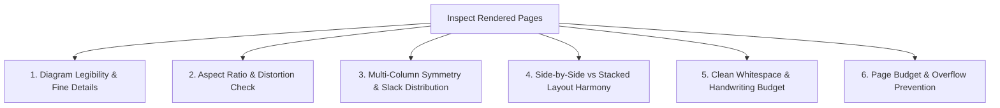

# Skill: visual-layout-checker

## Description

_Source: `C:\Users\zubair\Documents\GitHub\pdf-to-docx\.agents\skills\visual-layout-checker\SKILL.md`

```markdown
---
name: visual-layout-checker
description: Critically audits rendered DOCX and PDF document page images for visual alignment, diagram legibility, whitespace balance, multi-column symmetry, and typography formatting. Use after rendering to ensure high-fidelity deliverables without visual defects or page overflows.
---

# Visual & Layout Critical Checker Skill

This skill provides an objective, rigorous visual inspection protocol for evaluating rendered Microsoft Word (`.docx`) and LaTeX (`.pdf`) assessment pages.

It inspects rendered high-resolution page PNGs to verify that all figures, coordinate grids, mathematical notation, and student work areas are visually aligned, perfectly legible, and packed with balanced whitespace.

---

## 1. Page Rendering Protocol

Always render pages into `_temp/renders/` before inspection:

### A. Word Documents (.docx)
```bash
uv run worksheet-packer render-docx-pages output/Assessment.docx -o _temp/renders/docx_pages --dpi 200
```
*(Uses headless LibreOffice or Windows Word COM to render pixel-perfect page images `page_1.png`, `page_2.png`).*

### B. LaTeX / PDF Documents (.pdf)
Render PDF pages using PyMuPDF:
```bash
uv run python -c "import fitz, pathlib; doc = fitz.open('output/Assessment.pdf'); [page.get_pixmap(dpi=200).save(f'_temp/renders/pdf_pages/page_{i+1}.png') for i, page in enumerate(doc)]"
```

---

## 2. Visual Layout Audit Checklist

When reviewing rendered page images, evaluate every item against these 6 core criteria:



### 1. Diagram Legibility & Fine Details
- **Angle Marks & Arc Symbols:** Are angle labels (e.g., $120^\circ$, $x^\circ$, $\angle AHB$) crisp and clearly readable?
- **Point & Vertex Labels:** Are letters ($A, B, C, P, Q$) distinct and properly positioned near their vertices, not colliding with polygon edges?
- **Coordinate Grids:** Are grid lines visible, axis ticks numbered, and origin $(0,0)$ clear?
- **Code / Monospace Blocks:** Is code text legible with clean indentation and no clipping?

### 2. Aspect Ratio & Distortion Check
- **No Non-Uniform Stretching:** Circles must remain circular, squares must remain square. Diagrams must never be squished horizontally or stretched vertically.
- **Appropriate Scaling Ceiling:** Diagrams must look naturally proportioned—not cartoonishly oversized or microscopic.
- **No Dark/Dirty Backgrounds:** All diagram backgrounds must be pure white (`#FFFFFF`) or transparent, seamlessly matching the page background.

### 3. Multi-Column Symmetry & Slack Distribution
- **Column Balance:** In a 2-column layout, problems must be evenly distributed across columns (e.g. 3 questions in Column 0, 3 in Column 1). One column must never be crowded while the adjacent column has 5 inches of empty void.
- **Vertical Slack Fill:** Check that inter-problem spacing distributes vertical slack smoothly so questions fill the full height of the page naturally without abrupt gaps at the bottom.

### 4. Side-by-Side vs Stacked Layout Harmony
- **Side-by-Side Containers:** Square-ish or portrait diagrams ($0.55 \le AR \le 1.50$) should sit side-by-side with question text in borderless table cells. The diagram cell and text cell must have consistent vertical alignment (top-aligned).
- **Stacked Containers:** Wide diagrams (e.g. wide coordinate planes, multi-figure comparisons) must span the column width or page width with text positioned cleanly above the image.
- **No Text Collisions:** Text must never overlap or clip diagram borders.

### 5. Clean Whitespace & Handwriting Budget
- **Zero Blank Underlines:** Strictly verify that NO blank underlines (`_______` or `\hrule`) exist for student work.
- **Sufficient Work Area:** Blank workspace gaps must provide adequate space for student calculations:
  - 1-step arithmetic / simple MCQs: minimal whitespace or `workspace.type = none`.
  - Multi-step algebraic work: $0.6 - 1.0$ inches of clean whitespace.
  - Coordinate transformations or proofs: $1.0 - 1.5$ inches.

### 6. Page Budget & Overflow Prevention
- **Strict Page Count:** A 2-page document must be exactly 2 pages.
- **No Orphan Spills:** A single problem or answer line must never spill onto an unintended trailing page (e.g., Page 3 having only 2 lines of text).

---

## 3. Surgical Remediation Recipes

If the visual audit identifies issues, apply these direct fixes in `_temp/specs/worksheet_spec.json` and re-pack:

| Visual Defect | Root Cause | Surgical Fix in `worksheet_spec.json` |
| :--- | :--- | :--- |
| **Diagram too small / illegible** | `min_width_in` or `preferred_width_in` too low | Increase `min_width_in` to $2.0$ in or set `layout_hint = "stacked"` |
| **Diagram oversized** | `max_width_in` too high for column | Reduce `max_width_in` to $3.0$ in or `preferred_width_in` to $2.2$ in |
| **Awkward 1-line spill to next page** | Workspace heights or font slightly too large | Decrease `default_font_size_pt` by $0.5$ pt (e.g. $10.0 \to 9.5$) or reduce `workspace.approx_height_in` by $0.1$ in |
| **Uneven columns (4 vs 2)** | Section ordering constraint or tall problem | Set `"ordering": "flexible"` or set `layout_hint = "side_by_side"` |
| **Diagram stretched or blurry** | Generated raster image resolution low | Regenerate diagram script at `--dpi 300` and ensure aspect ratio matches native pixels |

---

## 4. Audit Procedure (Sequential, No Subagents)

> [!IMPORTANT]
> **Do not start subagents or use agent-delegation tools** (e.g., `invoke_subagent`, `task`). Microsoft Copilot and similar environments may not support them.

Perform the visual audit in the current session:
1. Render page images to `_temp/renders/docx_pages/` (or `pdf_pages/`).
2. Inspect each page against the Visual Layout Audit Checklist (legibility/aspect ratio, column balance/slack, layout harmony, clean whitespace, page budget/overflow).
3. Record a short per-page verdict and any defects.
4. If issues are found, update `_temp/specs/worksheet_spec.json` (or the relevant source), re-pack with `uv run worksheet-packer pack`, and re-render; re-audit affected pages.
5. Report the final verdict: `PASS` or `CORRECTED`, with a brief summary of changes.


```

## Notes
Sequential single-agent workflow (no subagents). For Copilot compatibility.

## Relevant Python Code


### src\worksheet_packer\docx_extractor.py

```python
"""DOCX Extraction and Headless Rendering Utilities.

Enables existing Word (.docx) documents to be ingested into the Worksheet Packer pipeline:
1. Extracts embedded media assets directly from word/media/ within the DOCX zip archive.
2. Renders DOCX pages to high-resolution PNG images via LibreOffice or Windows Word COM
   so they can be analyzed by Gemini multimodal vision.
"""

from __future__ import annotations
import os
import shutil
import subprocess
import zipfile
from pathlib import Path
from typing import Dict, List, Optional
import pymupdf as fitz


def extract_docx_media(docx_path: str | Path, output_dir: str | Path) -> Dict[str, Path]:
    """Extracts all embedded images from the word/media/ folder of a .docx file.

    Returns:
        Dictionary mapping internal media filename (e.g. 'image1.png') to extracted Path.
    """
    docx_file = Path(docx_path).resolve()
    out_dir = Path(output_dir).resolve()
    out_dir.mkdir(parents=True, exist_ok=True)

    extracted_map = {}
    if not zipfile.is_zipfile(docx_file):
        return extracted_map

    with zipfile.ZipFile(docx_file, "r") as z:
        for name in z.namelist():
            if name.startswith("word/media/"):
                filename = Path(name).name
                target_path = out_dir / filename
                with z.open(name) as src, open(target_path, "wb") as dst:
                    shutil.copyfileobj(src, dst)
                extracted_map[filename] = target_path

    return extracted_map


def convert_docx_to_pdf(docx_path: str | Path, output_pdf_path: Optional[str | Path] = None) -> Path:
    """Converts a DOCX document to PDF using headless LibreOffice or Windows Word COM.

    Raises:
        RuntimeError: If neither LibreOffice nor Word COM is available or conversion fails.
    """
    docx_file = Path(docx_path).resolve()
    if not docx_file.exists():
        raise FileNotFoundError(f"DOCX file not found: {docx_file}")

    if output_pdf_path is None:
        out_pdf = docx_file.with_suffix(".pdf")
    else:
        out_pdf = Path(output_pdf_path).resolve()

    out_pdf.parent.mkdir(parents=True, exist_ok=True)
    temp_dir = out_pdf.parent / f".temp_pdf_{docx_file.stem}"
    temp_dir.mkdir(parents=True, exist_ok=True)

    # 1. Try LibreOffice CLI
    soffice_cmd = shutil.which("soffice") or shutil.which("libreoffice")
    if not soffice_cmd:
        candidates = [
            Path(r"C:\Program Files\LibreOffice\program\soffice.exe"),
            Path(r"C:\Program Files (x86)\LibreOffice\program\soffice.exe"),
        ]
        for c in candidates:
            if c.exists():
                soffice_cmd = str(c)
                break

    if soffice_cmd:
        try:
            subprocess.run(
                [soffice_cmd, "--headless", "--convert-to", "pdf", str(docx_file), "--outdir", str(temp_dir)],
                check=True,
                capture_output=True,
                timeout=60,
            )
            candidate_pdf = temp_dir / f"{docx_file.stem}.pdf"
            if candidate_pdf.exists():
                shutil.move(str(candidate_pdf), str(out_pdf))
                shutil.rmtree(temp_dir, ignore_errors=True)
                return out_pdf
        except Exception:
            pass

    # 2. Try Windows MS Word COM
    if os.name == "nt":
        import time
        for attempt in range(3):
            try:
                import win32com.client  # type: ignore
                # Use DispatchEx for an isolated instance
                word = win32com.client.DispatchEx("Word.Application")
                word.Visible = False
                word.DisplayAlerts = 0  # wdAlertsNone
                try:
                    # Open read-only and unconfirmed
                    doc = word.Documents.Open(str(docx_file), ReadOnly=True, ConfirmConversions=False)
                    # 17 = wdFormatPDF
                    doc.SaveAs(str(out_pdf), FileFormat=17)
                    doc.Close(SaveChanges=False)
                    if out_pdf.exists() and out_pdf.stat().st_size > 0:
                        shutil.rmtree(temp_dir, ignore_errors=True)
                        return out_pdf
                finally:
                    word.Quit()
            except Exception as e:
                time.sleep(1.0)
                if attempt == 2:
                    shutil.rmtree(temp_dir, ignore_errors=True)
                    raise RuntimeError(f"Word COM conversion failed: {e}")

    shutil.rmtree(temp_dir, ignore_errors=True)
    raise RuntimeError(
        "Could not convert DOCX to PDF: neither LibreOffice CLI nor Windows MS Word COM automation succeeded."
    )


def render_docx_pages(
    docx_path: str | Path,
    output_dir: str | Path,
    dpi: int = 200,
) -> List[Path]:
    """Renders all pages of a Word document into high-resolution PNG images.

    Converts DOCX -> PDF, then renders each page using PyMuPDF.

    Returns:
        List of PNG paths for each page (1-indexed).
    """
    out_dir = Path(output_dir).resolve()
    out_dir.mkdir(parents=True, exist_ok=True)

    temp_pdf = out_dir / f"{Path(docx_path).stem}_rendered.pdf"
    convert_docx_to_pdf(docx_path, temp_pdf)

    rendered_pages = []
    doc = fitz.open(str(temp_pdf))
    try:
        zoom = dpi / 72.0
        mat = fitz.Matrix(zoom, zoom)
        for page_idx in range(len(doc)):
            page = doc[page_idx]
            pix = page.get_pixmap(matrix=mat, alpha=False)
            page_png = out_dir / f"page_{page_idx + 1}.png"
            pix.save(str(page_png))
            rendered_pages.append(page_png)
    finally:
        doc.close()

    return rendered_pages


```

### .agents\skills\pdf-to-docx\scripts\render_pages.py

_File not found in repo._

### .agents\skills\pdf-to-docx\scripts\diff_layout.py

_File not found in repo._

### src\pdf_to_docx\visual_diff.py

```python
"""Visual Diff and Self-Correction Engine.

Renders compiled DOCX documents headlessly and utilizes Gemini Flash vision
to inspect visual fidelity against original PDF page images.
"""

from __future__ import annotations
import json
import os
import shutil
import subprocess
from pathlib import Path
from typing import Any, Dict, List, Optional
import pymupdf as fitz
from pydantic import BaseModel, Field


class Discrepancy(BaseModel):
    category: str = Field(..., description="typography, table, chart, layout, image, margins")
    description: str
    severity: str = Field("medium", description="low, medium, high, critical")
    suggested_fix: str


class VisualCritique(BaseModel):
    fidelity_score: int = Field(..., ge=0, le=100, description="Overall layout fidelity score from 0 to 100")
    page_number: int
    matches_well: List[str] = Field(default_factory=list)
    discrepancies: List[Discrepancy] = Field(default_factory=list)
    actionable_adjustments: Dict[str, Any] = Field(default_factory=dict)


def render_docx_to_png(
    docx_path: str | Path,
    output_png_path: str | Path,
    page_number: int = 1,
    dpi: int = 200,
) -> Optional[Path]:
    """Attempts to render a DOCX page to PNG via available headless tools.

    Tries:
    1. LibreOffice ('soffice' or 'libreoffice' on PATH)
    2. Windows MS Word COM automation (if on Windows with Office installed)
    """
    docx_file = Path(docx_path).resolve()
    out_png = Path(output_png_path).resolve()
    out_png.parent.mkdir(parents=True, exist_ok=True)
    temp_dir = out_png.parent / ".temp_render"
    temp_dir.mkdir(parents=True, exist_ok=True)
    pdf_out = temp_dir / f"{docx_file.stem}.pdf"

    converted = False

    # 1. Try LibreOffice CLI
    soffice_cmd = shutil.which("soffice") or shutil.which("libreoffice")
    if not soffice_cmd:
        # Check standard Windows paths
        win_candidates = [
            Path(r"C:\Program Files\LibreOffice\program\soffice.exe"),
            Path(r"C:\Program Files (x86)\LibreOffice\program\soffice.exe"),
        ]
        for c in win_candidates:
            if c.exists():
                soffice_cmd = str(c)
                break

    if soffice_cmd:
        try:
            subprocess.run(
                [soffice_cmd, "--headless", "--convert-to", "pdf", str(docx_file), "--outdir", str(temp_dir)],
                check=True,
                capture_output=True,
                timeout=60,
            )
            if pdf_out.exists():
                converted = True
        except Exception:
            pass

    # 2. Try Windows Word COM if LibreOffice unavailable
    if not converted and os.name == "nt":
        try:
            import win32com.client  # type: ignore
            word = win32com.client.Dispatch("Word.Application")
            word.Visible = False
            doc = word.Documents.Open(str(docx_file))
            # 17 = wdFormatPDF
            doc.SaveAs(str(pdf_out), FileFormat=17)
            doc.Close()
            word.Quit()
            if pdf_out.exists():
                converted = True
        except Exception:
            pass

    if not converted or not pdf_out.exists():
        return None

    # Render PDF page to PNG using PyMuPDF
    doc = fitz.open(str(pdf_out))
    if page_number > len(doc):
        page_number = 1
    page = doc[page_number - 1]
    zoom = dpi / 72.0
    mat = fitz.Matrix(zoom, zoom)
    pix = page.get_pixmap(matrix=mat, alpha=False)
    pix.save(str(out_png))
    doc.close()

    # Clean up temp PDF
    try:
        shutil.rmtree(temp_dir, ignore_errors=True)
    except Exception:
        pass

    return out_png


DIFF_PROMPT = """You are a document layout QA expert. Compare these two images side-by-side:
Image 1: ORIGINAL PDF PAGE (Reference standard)
Image 2: GENERATED WORD (.DOCX) PAGE (Compiled output)

Perform a meticulous layout discrepancy analysis:
1. Typography & Hierarchy: Are heading sizes, weights, and colors faithfully reproduced?
2. Tables: Are table columns properly proportioned, borders crisp, cell padding balanced, headers distinct?
3. Charts & Figures: Are chart dimensions, titles, and legends placed accurately?
4. Page Flow: Did any content overflow or wrap awkwardly?
5. Assign a fidelity score from 0-100 and provide clear, actionable suggestions to adjust the styling AST or docx-mcp properties.
"""


class VisualDiffInspector:
    """Uses Gemini multimodal capabilities to critique and guide self-correction."""

    def __init__(self, api_key: Optional[str] = None, model_name: str = "gemini-2.5-flash"):
        self.api_key = api_key or os.environ.get("GEMINI_API_KEY")
        self.model_name = model_name
        self._client = None

    @property
    def client(self):
        if self._client is None:
            from google import genai
            import logging
            logging.getLogger("google_genai.models").addFilter(
                lambda record: "automatic function calling (AFC)" not in record.getMessage()
            )
            if self.api_key:
                self._client = genai.Client(api_key=self.api_key)
            else:
                self._client = genai.Client()
        return self._client

    def inspect_and_critique(
        self,
        original_image_path: str | Path,
        rendered_image_path: str | Path,
        page_number: int = 1,
    ) -> VisualCritique:
        """Sends original vs rendered DOCX page to Gemini Flash for critique."""
        from google.genai import types

        orig_bytes = Path(original_image_path).read_bytes()
        rend_bytes = Path(rendered_image_path).read_bytes()

        response = self.client.models.generate_content(
            model=self.model_name,
            contents=[
                types.Part.from_bytes(data=orig_bytes, mime_type="image/png"),
                types.Part.from_bytes(data=rend_bytes, mime_type="image/png"),
                DIFF_PROMPT,
            ],
            config=types.GenerateContentConfig(
                response_mime_type="application/json",
                response_schema=VisualCritique,
                temperature=0.2,
                automatic_function_calling=types.AutomaticFunctionCallingConfig(disable=True),
            ),
        )

        try:
            data = json.loads(response.text)
            critique = VisualCritique.model_validate(data)
            critique.page_number = page_number
            return critique
        except Exception:
            raw_text = response.text.strip()
            if raw_text.startswith("```json"):
                raw_text = raw_text.split("```json", 1)[1].split("```", 1)[0].strip()
            elif raw_text.startswith("```"):
                raw_text = raw_text.split("```", 1)[1].split("```", 1)[0].strip()
            data = json.loads(raw_text)
            critique = VisualCritique.model_validate(data)
            critique.page_number = page_number
            return critique

```
